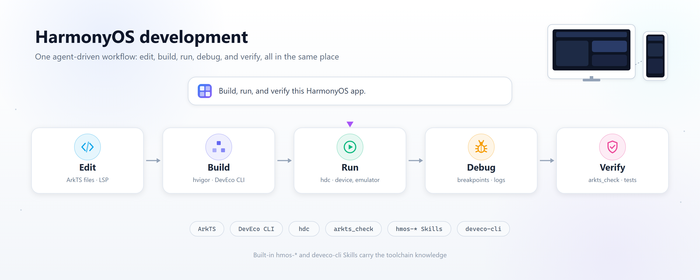
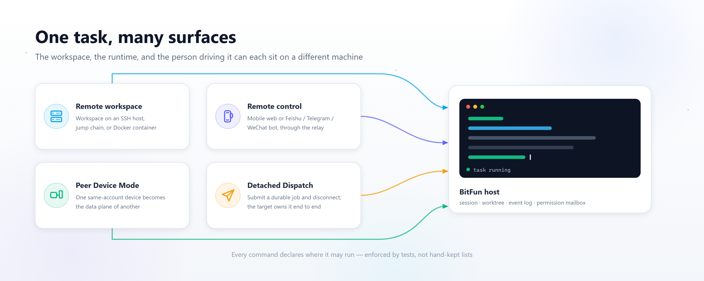

[中文](README.zh-CN.md) | **English**

### Built to keep going.

BitFun is an open-source, cross-platform Agent workspace. A fast, reliable **Rust Agent Runtime**, a flexible **Agent Harness**, and Tauri-based desktop shells turn agent work into something you can actually get done: write code, fix bugs, research a topic, draft reports, and build the small tools your own work needs.

It runs natively on **Windows**, **macOS**, and **HarmonyOS PC**, with a HarmonyOS host, platform bridges, and a HarmonyOS development toolchain of its own.

[Website](https://www.bitfun.work/) | [Download](https://www.openbitfun.com/download) | [Contribute](./CONTRIBUTING.md) | [Release notes](./RELEASE_NOTES.md)

## What BitFun can do for you

**BitFun turns natural language into work that actually lands.** One instruction is decomposed into steps and carried out end to end, with AI running the whole way, so code, documents, research, and the small tools your own work needs all come from the same place.

| Scenario | What it covers |
| --- | --- |
| **Code** | Write code, run builds, and ship HarmonyOS apps end to end: edit, build, run, debug, and verify |
| **Work** | Write documents, run research, and analyze data for everyday office tasks |
| **Assist** | Remember preferences, carry out tasks, and keep following up over time |

The product core stays platform-agnostic: the Agent Runtime, tools, and services are one implementation, and platform differences live only in the hosts, adapters, and services that genuinely differ, so each platform gets native behavior without a forked product. The details are in [platform-portability-design.md](./docs/architecture/platform-portability-design.md).

## Four modes for the way you work

**The Agent Harness shapes how a task gets done.** It plans steps, manages context, calls tools, coordinates agents, and brings their results together. Choose the mode that fits the task:

| Mode | When to use it |
| --- | --- |
| **Minimal** | **Quick collaboration.** Start with a clear goal. The agent acts directly, you give feedback, and you refine the work together. |
| **Standard** | **Everyday tasks.** For work with several steps: plan the approach, work through it, and check the results. |
| **Ultimate** | **Complex tasks.** Dig into demanding problems, divide the work among agents, and bring their results together. |
| **Creative** | **Creation and customization.** Build Mini Apps or extend BitFun's interface and capabilities to make the workspace your own. |

## HarmonyOS development

HarmonyOS PC is a first-class target, not a side surface. BitFun brings a **HarmonyOS Harness, Skills, toolchain, and knowledge base** together so creating an app is one workflow from edit to build to run, debug, and verify.

| Capability | What it does |
| --- | --- |
| **HarmonyOS app development** | Edit, build, run, debug, and verify HarmonyOS projects. `arkts_check` and the DevEco command-line tools run against your project, and the built-in `hmos-*` and `deveco-cli` Skills carry the toolchain knowledge |
| **QT migration expert** | Built-in QT migration knowledge base and Skill: it recognizes QT API calls and layout, then generates the matching ArkTS implementation, so an existing QT project moves to HarmonyOS smoothly |
| **Deep Review** | Design review, test coverage, and code review raise engineering quality and catch risk at the source |

## Multi-device collaboration

**One account, several devices, one continuous task.** Lightly tap to connect a HarmonyOS PC with phones and tablets, move files, images, and text across devices, and keep work going as you switch between them.

- **Tap to connect** — a light tap links a HarmonyOS PC with mobile devices.
- **Send across devices** — move files, images, and text without repeating yourself.
- **Follow up and remember** — preferences and work habits are retained, routine tasks are handled, long-running items are tracked, and reminders arrive at the right moment, so every session continues from the context you already have.

## One task, many surfaces

BitFun is not a local-only desktop app. The workspace, the runtime that executes a turn, and the person driving it can each sit on a different machine, and all four remote scenarios below are first-class targets rather than later additions:

| Scenario | What it means | Where to read more |
| --- | --- | --- |
| **Remote workspace** | The active workspace lives on an SSH host, a jump-host chain, or a Docker container; files, terminal, search, and agent subprocesses run there | [remote-workspaces.md](./docs/features/remote-workspaces.md) |
| **Remote control** | Mobile web or a Feishu / Telegram / WeChat bot drives a session on a desktop or CLI host through the Remote Connect relay | [mobile-web](./src/mobile-web/README.md) |
| **Peer Device Mode** | One same-account device becomes the data plane of another: the controller shell stays local, invokes and events come from the peer | [peer-device-mode.md](./docs/architecture/peer-device-mode.md) |
| **Detached Dispatch** | A controller submits a durable job to another BitFun host and may then disconnect; the target owns the job, session, worktree, event log, and permission mailbox | [detached-task-dispatch.md](./docs/architecture/detached-task-dispatch.md) |

Which commands may run where is declared in the [Product Operation Registry](./docs/architecture/remote-surface-contract.md) and enforced by tests, not hand-kept lists.

## License

BitFun is distributed through GitCode. Core code is licensed under the [MIT License](./LICENSE); third-party dependencies and assets retain their own licenses. To report a vulnerability, see the [security policy](./SECURITY.md).
