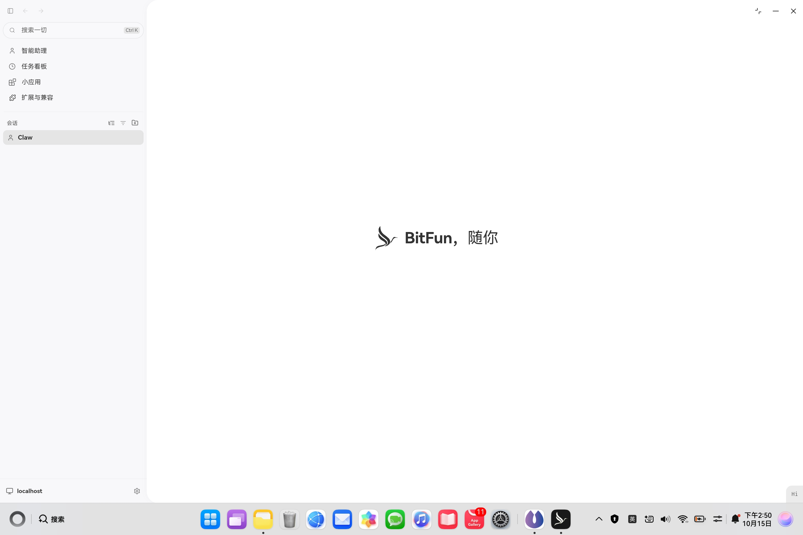
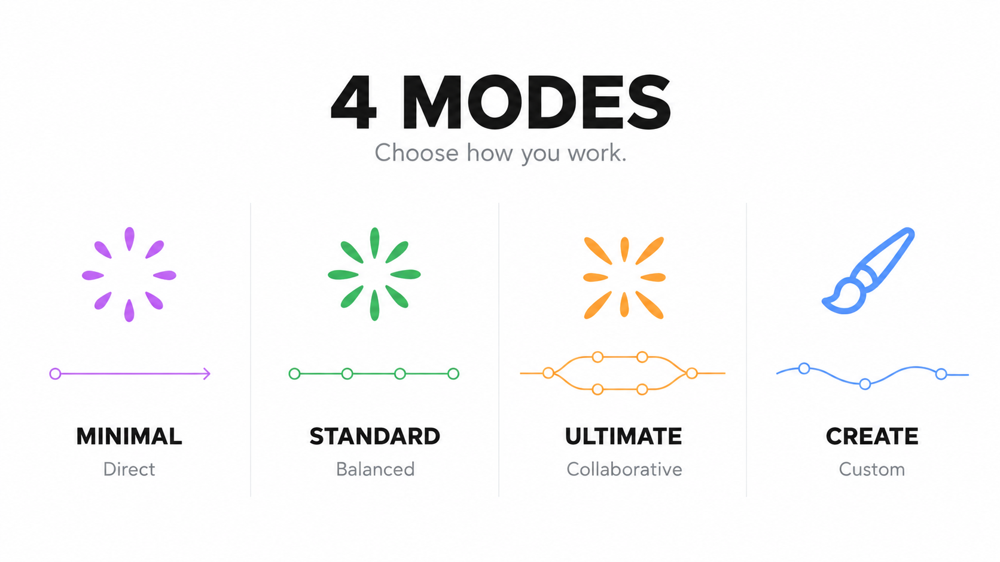
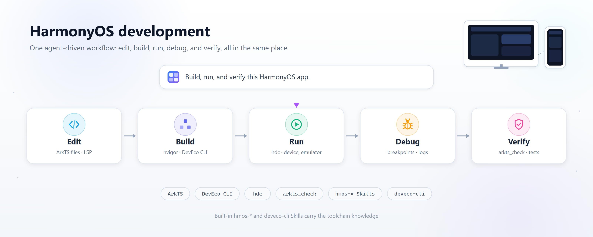
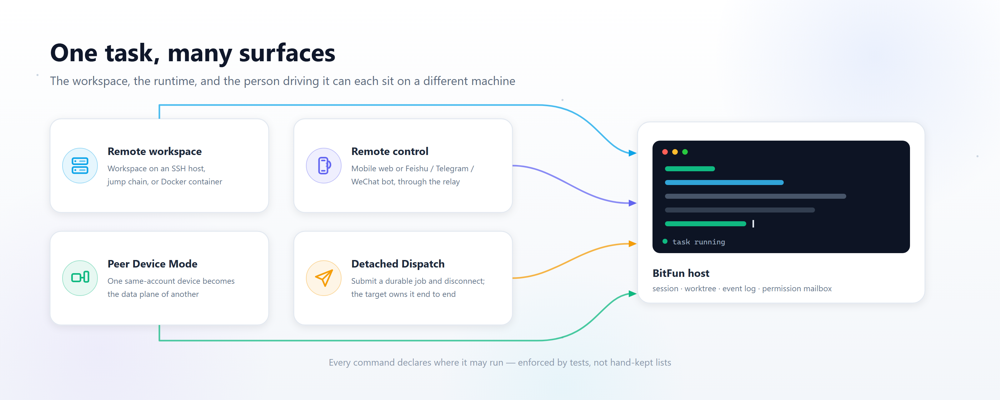

**中文** | [English](README.md)

<div align="center">


### 持续推进，直到完成。

BitFun 是一个开源的跨平台 Agent 工作台：高效稳健的 **Rust Agent Runtime**、可塑的 **Agent Harness**，配合基于 Tauri 的桌面包体，让 Agent 真正替你写代码、修 Bug、查资料、写报告，并做出工作里需要的小工具。

它原生支持 **Windows**、**macOS** 与 **HarmonyOS PC**，并自带鸿蒙宿主、平台桥接与鸿蒙开发工具链。

[官网](https://www.bitfun.work/) | [下载](https://gitcode.com/OpenBitFun/bitfun_ade/releases) | [参与共建](./CONTRIBUTING_CN.md) | [版本说明](./RELEASE_NOTES.md)

[](./LICENSE)
[](https://www.bitfun.work/)
[](https://www.bitfun.work/)

## 加入社区群

使用微信扫描下方二维码，添加好友后申请加入 OpenBitFun 社区群。

<a href="./png/openbitfun-community-wechat.png">
  
</a>

</div>



## BitFun 能为你做什么

**BitFun 把自然语言变成真正交付的成果。** 一句话指令自动拆解任务、全程执行，写代码、做文档、做调研，以及工作里需要的小工具，都出自同一个地方。

| 场景 | 覆盖范围 |
| --- | --- |
| **代码** | 写代码、跑构建，覆盖编辑、构建、运行、调试与验证，鸿蒙应用开发一站搞定 |
| **办公** | 写文档、做调研、分析数据，高效处理日常工作 |
| **助理** | 记偏好、办任务、持续跟进，越用越懂你 |

产品核心保持与平台无关：Agent Runtime、工具与服务只有一套实现，平台差异只留在确实存在差异的宿主、适配器与服务边界里，各平台都是原生体验，而不是分叉出的另一套产品。细节见[平台可移植性规约](./docs/architecture/platform-portability-design.md)。

## 四种模式，按你的方式工作

**Agent Harness 决定任务如何推进**，负责规划步骤、组织上下文、调用工具、协调多个 Agent 并整合结果。根据当前任务选择适合的协作方式：



| 模式 | 什么时候选 |
| --- | --- |
| **极简 · Minimal** | **即时协作。** 目标明确、希望快速动手时，AI 直接执行，你随时反馈，在协作中持续调整。 |
| **标准 · Standard** | **日常任务。** 工作需要多个步骤时，有序规划、逐步执行，并检查结果。 |
| **极致 · Ultimate** | **复杂任务。** 问题需要深入分析时，拆解任务，由多个 Agent 分工协作、整合结果。 |
| **创造 · Creative** | **创造与定制。** 想做自己的应用或扩展工作台时，创建 Mini App，定制 BitFun 的界面与功能。 |

## 鸿蒙开发

鸿蒙 PC 是一等目标，而不是附属形态。BitFun 把**鸿蒙 Harness、Skills、工具链与知识库**融合在一起，让应用开发从编辑到构建、运行、调试、验证走通同一条流程。



| 能力 | 说明 |
| --- | --- |
| **鸿蒙应用开发** | 覆盖编辑、构建、运行、调试与验证。`arkts_check` 与 DevEco 命令行工具直接作用于你的工程，内置 `hmos-*` 与 `deveco-cli` 技能承载工具链知识 |
| **QT 迁移专家** | 内置 QT 迁移知识库与 Skill：智能识别 QT API 调用与界面布局，自动生成对应的 ArkTS 实现，让现有 QT 工程平滑迁移到鸿蒙生态 |
| **代码审核专家** | 深度审核 / DeepReview：通过设计审查、测试覆盖与代码审查提升工程水准，从源头化解风险 |

## 多设备协同

**一个账号、多台设备、同一个任务持续推进。** 轻触即可连接鸿蒙 PC 与移动端设备，文件、图片、文本等内容跨设备传送，切换设备也能快速接续。

- **一碰即连**：轻触即可连接鸿蒙 PC 与移动端设备。
- **跨设备传送**：文件、图片、文本便捷传送，减少重复操作。
- **跟进与记忆**：记住你的偏好与工作习惯，代办日常任务、跟进长期事项，并在关键节点主动提醒，让每次协作都从已有上下文继续。

## 一个任务，多个入口

BitFun 不是本地单机应用。工作区、执行任务的运行时、以及驱动它的人，可以分别在不同机器上；以下四种远程场景都是一等目标，而不是事后补充：



| 场景 | 含义 | 延伸阅读 |
| --- | --- | --- |
| **远程工作区** | 活动工作区位于 SSH 主机、跳板机链或 Docker 容器中，文件、终端、搜索与 Agent 子进程都在目标环境执行 | [remote-workspaces.md](./docs/features/remote-workspaces.md) |
| **远程控制** | 移动 Web 或飞书 / Telegram / 微信机器人，经由 Remote Connect relay 驱动桌面或 CLI 宿主上的会话 | [移动 Web 遥控端](./src/mobile-web/README.md) |
| **Peer Device Mode** | 同账号的一台设备成为另一台的数据面：控制端外壳留在本地，调用与事件来自对端 | [peer-device-mode.md](./docs/architecture/peer-device-mode.md) |
| **Detached Dispatch** | 控制端把持久任务提交到另一台 BitFun 宿主后可以断开；任务、会话、worktree、事件日志与权限信箱都归目标端持有 | [detached-task-dispatch.md](./docs/architecture/detached-task-dispatch.md) |

哪条命令可以在哪里运行，由 [Product Operation Registry](./docs/architecture/remote-surface-contract.md) 统一声明，并由测试兜底，而不是手工维护的清单。

## 许可证

BitFun 通过 GitCode 分发。描述需求，让 Agent 创建应用。每个 Mini App 都有自己的界面和 Agent 会话：你可以操作界面处理任务，也可以通过对话调整功能，让工具在使用中不断完善。

做好的应用可以安装、反复使用。你也可以去 [Mini App 市场](https://market.bitfun.com/miniapp/)发现适合自己的工具。

## 用 BitFun，创造 BitFun

**从角色、工具到界面和源码，都可以按需定制。** 从贴合工作习惯的专属 Agent 开始，逐步扩展你的工作台：

- **定制专属 Agent。** 围绕漫剧创作、视觉设计、代码评审等领域，选择模型、设定角色，组合需要的工具与工作方法。
- **接入工具与流程。** 通过 MCP 连接专业工具，把常用工作方法保存为 Skills，用 Hooks 扩展任务执行流程。
- **改变界面与源码。** 选择内置主题调整外观，也可以修改 UI、工具与 Runtime 源码，构建自己的 BitFun。

**你可以直接让 BitFun 的 Code Agent 修改和扩展 BitFun 本身。**

扩展方式见 [Agent 管理](./docs/interactive-capabilities/capabilities/feature.agents.md)、[Hooks 契约与兼容范围](./docs/features/agent-hooks.zh-CN.md)和[产品架构](./docs/architecture/product-architecture.md)。

## 持续执行，也认真对待效率

Rust Agent Runtime 承载会话状态、上下文管理与工具执行。持久会话、中断恢复、长期记忆与长程任务支持工作接续；上下文压缩和缓存复用帮助控制持续执行的资源开销。

在这组 **DeepSWE v1.1** 评测中，BitFun 的表现：

- **GLM-5.3-Flash**：通过率 **64.6%**，耗时 P50 **42.9 分钟**。
- **DeepSeek-V4-Flash**：通过率 **56.6%**，耗时 P50 **19.6 分钟**。


## 功能墙

**图中只是 BitFun 的部分功能。** 还有更多工具、工作流与扩展能力，等你在真实任务中探索。


## 我们想走向的未来

BitFun 仍在演进，我们希望继续探索三个方向：

- **黑灯工厂**：白天讨论与设计，让任务在服务器上持续推进，第二天回到成果与验收。
- **无限半径**：从桌面与手机继续走向穿戴和嵌入式设备，让工作在更多地方接续。
- **应用进化**：从个人小工具到面向专业领域的定制版本，让更多人参与塑造软件。

更可靠的长任务、更高效的 Runtime、更从容的桌面体验，是这些探索共同的基础。

## 用它创造，也一起创造它

**欢迎用作品、反馈和代码参与 BitFun 的未来。**

你可以分享真实任务与使用经验，贡献 Agent、Skills、Mini App 和皮肤，也可以从一处文档、一项交互或一个 Runtime 问题开始。想法与问题欢迎在本仓库的 Issues 和 Discussions 中讨论，开发流程见[贡献指南](./CONTRIBUTING_CN.md)。

<details>
<summary>下载、使用与源码运行</summary>

前往[官方下载页](https://bitfun.com/zh/download)，选择 Windows、macOS 或 Linux 安装包。安装后配置模型，打开工作区即可开始；操作说明见[使用手册](https://playbook.bitfun.com)，安装包签名见[下载校验](./docs/verify-downloads.zh-CN.md)。

**数据迁移提醒：** BitFun 1.0.0 与 0.2.x 旧版数据不互通。需要迁移旧版数据时，请使用
[BitFun 数据工具](src/apps/data-tools/README.zh-CN.md)，当前支持 0.2.17～0.2.19 正式版。

从源码运行需准备 [Node.js](https://nodejs.org/) 22.12+、[pnpm](https://pnpm.io/) 10.15.0、[Rust 工具链](https://rustup.rs/)和 [Tauri 前置依赖](https://v2.tauri.app/start/prerequisites/)。克隆本仓库后运行：

```bash
pnpm install
pnpm run desktop:dev
```

桌面开发环境支持前端热更新与 Rust 自动重编译。CLI 入口见 [CLI 使用说明](./src/apps/cli/README.md)。

</details>

核心代码采用 [MIT License](./LICENSE)，第三方依赖与资源遵循各自的许可证。BitFun 通过 GitCode 分发。感谢所有开源作者与贡献者。漏洞报告方式见[安全策略](./SECURITY_CN.md)。
