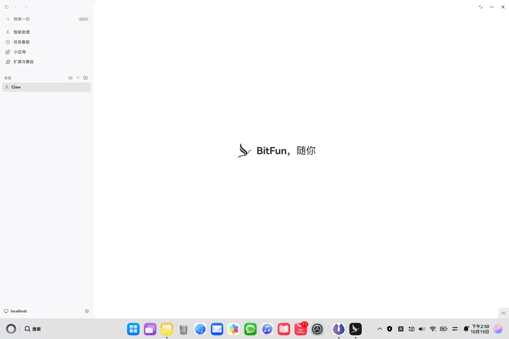
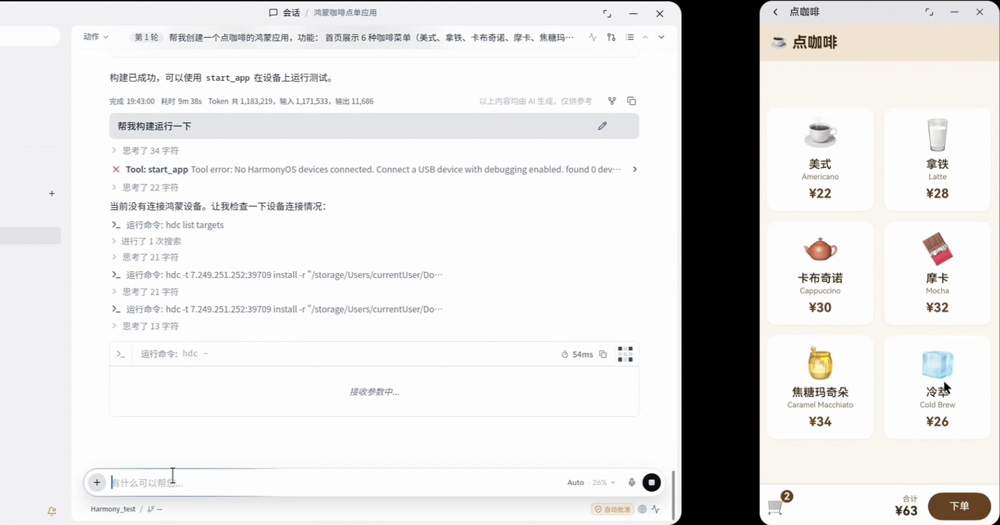
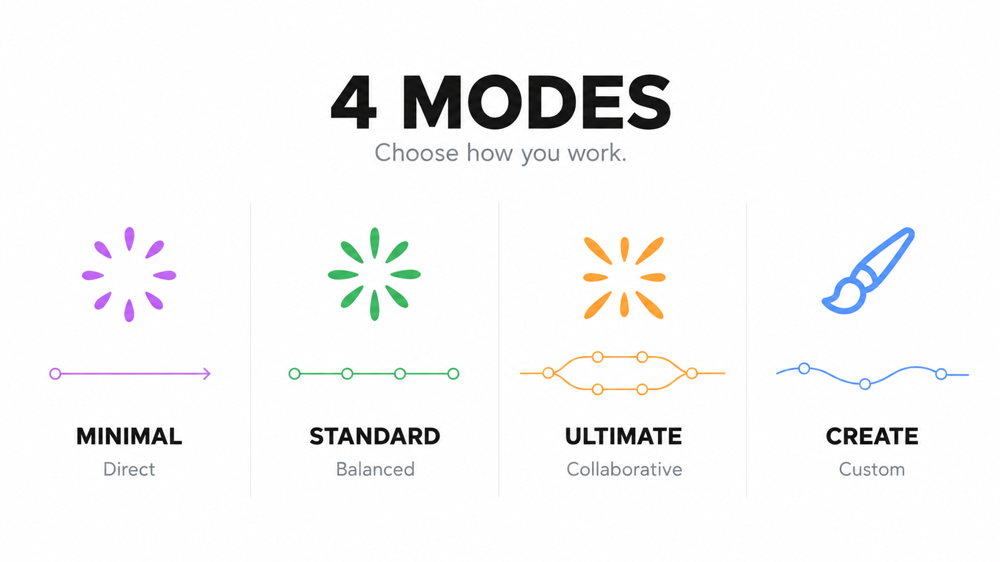

**中文** | [English](README.md)

<div align="center">


### 持续推进，直到完成。

BitFun 是一个开源的跨平台 Agent 工作台：高效稳健的 **Rust Agent Runtime**、可塑的 **Agent Harness**，配合基于 Tauri 的桌面包体，让 Agent 真正替你写代码、修 Bug、查资料、写报告，并做出工作里需要的小工具。

它原生支持 **Windows**、**macOS** 与 **HarmonyOS PC**，并自带鸿蒙宿主、平台桥接与鸿蒙开发工具链。

[官网](https://www.bitfun.work/) | [参与共建](./CONTRIBUTING_CN.md) | [版本说明](./RELEASE_NOTES.md) | [产品架构](./docs/architecture/product-architecture.md)

[](./LICENSE)
[](https://www.bitfun.work/)
[](https://www.bitfun.work/)

</div>



## 平台支持

BitFun 支持 **Windows**、**macOS** 与 **HarmonyOS PC**。产品核心保持与平台无关：Agent Runtime、工具与服务只有一套实现，平台差异只留在确实存在差异的宿主、适配器与服务边界里，各平台都是原生体验，而不是分叉出的另一套产品。

平台边界与鸿蒙设计事实见[平台可移植性规约](./docs/architecture/platform-portability-design.md)。能力覆盖按能力逐项说明，而不是按平台名称笼统声明。

## 代码、办公与助理

**BitFun 把自然语言变成真正交付的成果。** 一句话指令自动拆解任务、全程执行，写代码、做文档、做调研，以及工作里需要的小工具，都出自同一个地方。

| 场景 | 覆盖范围 |
| --- | --- |
| **代码** | 写代码、跑构建，覆盖编辑、构建、运行、调试与验证，鸿蒙应用开发一站搞定 |
| **办公** | 写文档、做调研、分析数据，高效处理日常工作 |
| **助理** | 记偏好、办任务、持续跟进，越用越懂你 |

## 鸿蒙开发

鸿蒙 PC 是一等目标，而不是附属形态。BitFun 把**鸿蒙 Harness、Skills、工具链与知识库**融合在一起，让应用开发从编辑到构建、运行、调试、验证走通同一条流程。



| 能力 | 说明 |
| --- | --- |
| **鸿蒙应用开发** | 覆盖编辑、构建、运行、调试与验证。`arkts_check` 与 DevEco 命令行工具直接作用于你的工程，内置 `hmos-*` 与 `deveco-cli` 技能承载工具链知识 |
| **QT 迁移专家** | 内置 QT 迁移知识库与 Skill：智能识别 QT API 调用与界面布局，自动生成对应的 ArkTS 实现，让现有 QT 工程平滑迁移到鸿蒙生态 |
| **代码审核专家** | 深度审核 / DeepReview：通过设计审查、测试覆盖与代码审查提升工程水准，从源头化解风险 |

## 多设备协同

**一个账号、多台设备、同一个任务持续推进。** 轻触即可连接鸿蒙 PC 与移动端设备，文件、图片、文本等内容跨设备传送，切换设备也能快速接续。

- **一碰即连**：轻触即可连接鸿蒙 PC 与移动端设备。
- **跨设备传送**：文件、图片、文本便捷传送，减少重复操作。
- **跟进与记忆**：记住你的偏好与工作习惯，代办日常任务、跟进长期事项，并在关键节点主动提醒，让每次协作都从已有上下文继续。

## 四种模式，按你的方式工作

**Agent Harness 决定任务如何推进**，负责规划步骤、组织上下文、调用工具、协调多个 Agent 并整合结果。Harness 标识由共享契约 `src/shared/agent-harness/contract.json` 约束；根据当前任务选择适合你的协作方式：



| 模式 | 什么时候选 |
| --- | --- |
| **极简 · Minimal** | **即时协作。** 目标明确、希望快速动手时，AI 直接执行，你随时反馈，在协作中持续调整。 |
| **标准 · Standard** | **日常任务。** 工作需要多个步骤时，有序规划、逐步执行，并检查结果。 |
| **极致 · Ultimate** | **复杂任务。** 问题需要深入分析时，拆解任务，由多个 Agent 分工协作、整合结果。 |
| **创造 · Creative** | **创造与定制。** 想做自己的应用或扩展工作台时，创建 Mini App，定制 BitFun 的界面与功能。 |

## 一个任务，多个入口

BitFun 不是本地单机应用。工作区、执行任务的运行时、以及驱动它的人，可以分别在不同机器上。以下四种远程场景都是需要与功能一起设计的一等目标，而不是事后补充：

| 场景 | 含义 | 设计入口 |
| --- | --- | --- |
| **远程工作区** | 活动工作区位于 SSH 主机、跳板机链或 Docker 容器中，文件、终端、搜索与 Agent 子进程都在目标环境执行 | [remote-workspace-transport.md](./docs/architecture/remote-workspace-transport.md)、[remote-workspaces.md](./docs/features/remote-workspaces.md) |
| **远程控制** | 移动 Web 或飞书 / Telegram / 微信机器人，经由 Remote Connect relay 驱动桌面或 CLI 宿主上的会话 | [src/mobile-web/README.md](./src/mobile-web/README.md)、[relay-server](./src/apps/relay-server/README.md) |
| **Peer Device Mode** | 同账号的一台设备成为另一台的数据面：控制端外壳留在本地，调用与事件来自对端 | [peer-device-mode.md](./docs/architecture/peer-device-mode.md) |
| **Detached Dispatch** | 控制端把持久任务提交到另一台 BitFun 宿主后可以断开；任务、会话、worktree、事件日志与权限信箱都归目标端持有 | [detached-task-dispatch.md](./docs/architecture/detached-task-dispatch.md) |

"某条命令可以在哪里运行"不再依靠手工维护的多份清单：每个已注册的产品命令都在 Product Operation Registry 中声明其远程立场，桌面闭包测试与能力生成器会拒绝没有登记的命令。见[远程表面契约](./docs/architecture/remote-surface-contract.md)。

## 鸿蒙 PC 形态

| 形态 | 路径 | 说明 |
| --- | --- | --- |
| **鸿蒙宿主（HAP）** | `src/apps/ohos` | ArkTS 宿主与平台桥接。`EntryAbility.ets` 通过 `@ohos-rs/ability` 加载嵌入 ArkTS 的 Rust 库 `libbitfun_desktop_lib.so` 并渲染复用的 Web UI；窗口边框、状态栏托盘、分享、语音输入、截屏、凭据存储与应用更新都在这里桥接。 |
| **桌面集成层** | `src/apps/desktop` | 共享 Tauri 宿主。鸿蒙专属命令与桥接位于 `src/api/ohos/`，由 `target_env = "ohos"` 条件编译隔离。 |
| **鸿蒙移动控制器** | `src/apps/mobile/harmonyos` | 面向桌面或 CLI 宿主的手机 / 折叠屏 / 平板遥控端。它不运行 Agent Runtime、不保存模型配置：登录 GitHub、选择设备、下发任务。 |

共享核心在这个目标上主动裁掉仅桌面可用的原生依赖：鸿蒙构建用 `lzma-rs` 替代 C 后端的 `xz2`，链接 `napi-ohos`，并用 ArkTS 支撑的凭据库替代 D-Bus 的 `system-vault`。

## 把想法，变成自己的应用

为仓库做一个 Git 洞察面板，为演示文稿做一个 PPT 工作台，或把常用操作集中到一张表单。**Mini App 让工作中的具体需求，变成可直接使用的小应用。** 描述需求，让 Agent 创建应用；每个 Mini App 都有自己的界面和 Agent 会话。

HAP 构建还会把随包 MiniApp（`src/apps/mobile/harmonyos/miniapps`）打包进生成的 raw resources。这些页面在 ArkWeb 中本地运行，无需登录、配对、连接桌面或联网；其存储与剪贴板写入都留在本机。

## 用 BitFun，创造 BitFun

**从角色、工具到界面和源码，都可以按需定制。** 从贴合工作习惯的专属 Agent 开始，逐步扩展你的工作台：

- **定制专属 Agent。** 围绕代码评审、鸿蒙开发、视觉设计等领域，选择模型、设定角色，组合需要的工具与工作方法。
- **接入工具与流程。** 通过 MCP 连接专业工具，把常用工作方法保存为 Skills，用 Hooks 扩展任务执行流程。
- **改变界面与源码。** 安装外观包调整外观，也可以修改 UI、工具与 Runtime 源码，构建自己的 BitFun。

**你可以直接让 BitFun 的 Code Agent 修改和扩展 BitFun 本身。** 扩展方式见 [Agent 管理](./docs/interactive-capabilities/capabilities/feature.agents.md)、[Hooks 契约与兼容范围](./docs/features/agent-hooks.md)和[产品架构](./docs/architecture/product-architecture.md)。

## 仓库结构

| 路径 | 内容 |
| --- | --- |
| `src/apps` | 产品宿主与入口：`desktop`、`cli`、`ohos`、`mobile`、`relay-server`、`server`、`sdk-host`、`extension-host`、`data-migrator` 及市场服务 |
| `src/crates` | Rust 分层：`contracts` -> `execution` -> `services` -> `adapters` -> `assembly` -> `interfaces` |
| `src/web-ui`、`src/mobile-web`、`src/shared` | React Web UI、移动 Web 遥控端与共享生成契约 |
| `src/crates/assembly/core/builtin_skills` | 内置 Skills，含鸿蒙开发技能组 |
| `design-system`、`website`、`sdk`、`extensions`、`packages` | 设计系统、Playbook 站点、TypeScript SDK 切片与生态桥接 |
| `deploy`、`products`、`tests/e2e`、`docs` | 部署手册、产品定义、E2E 测试，以及架构与特性文档 |

分层归属、依赖方向与边界规则见 [AGENTS.md](./AGENTS.md) 与[产品架构](./docs/architecture/product-architecture.md)。

## 我们想走向的未来

BitFun 仍在演进，我们希望继续探索三个方向：

- **黑灯工厂**：白天讨论与设计，让任务在服务器上持续推进，第二天回到成果与验收。
- **无限半径**：从桌面与手机继续走向穿戴和嵌入式设备，让工作在更多地方接续。
- **应用进化**：从个人小工具到面向专业领域的定制版本，让更多人参与塑造软件。

更可靠的长任务、更高效的 Runtime、更从容的桌面体验，是这些探索共同的基础。

## 按需迁移旧版数据

数据迁移是可选操作，请按需**单独下载 BitFun 数据迁移器**。工具独立运行，不随主应用打包，也不会由主应用自动启动。下载、兼容范围、操作步骤与中断恢复见[迁移器使用说明](src/apps/data-migrator/README.zh-CN.md)。

## 下载安装

**全开源鸿蒙智能体开发环境，安装后即可使用 AI 智能体完成真实工程任务。**

| 平台 | 要求 | 下载 |
| --- | --- | --- |
| **Windows** | Windows 10 / 11 | [Windows 版](https://www.openbitfun.com/download) |
| **macOS** | macOS 13 或更高版本 | [macOS 版](https://www.openbitfun.com/download) |
| **HarmonyOS** | HarmonyOS 5 或更高版本 | [应用市场](https://appgallery.huawei.com/app/detail?id=com.develop.opensource.ohpcd.bitfun) |

完整产品介绍与下载入口见[官网](https://www.bitfun.work/)。

## 用它创造，也一起创造它

**欢迎分享你的作品、反馈和代码，一起塑造它的未来。**

你可以分享真实任务与使用经验，贡献 Agent、Skills、Mini App 和外观包，也可以从一处文档、一项交互或一个 Runtime 问题开始。想法与问题欢迎在本仓库的 Issues 和 Discussions 中讨论；开发流程见[贡献指南](./CONTRIBUTING_CN.md)，每个鸿蒙 PC 版本落地了什么见[版本说明](./RELEASE_NOTES.md)。

<details>
<summary>开发环境准备</summary>

从源码运行需准备 [Node.js](https://nodejs.org/) 22.12+、[pnpm](https://pnpm.io/) 10.15.0、[Rust 工具链](https://rustup.rs/)和 [Tauri 前置依赖](https://v2.tauri.app/start/prerequisites/)。克隆本仓库后运行：

```bash
pnpm install
pnpm run desktop:dev
```

桌面开发环境支持前端热更新与 Rust 自动重编译。构建报出难以理解的资源或下载错误时，运行 `pnpm run check:build-prereqs` 定位缺失的前置条件。CLI 入口见 [CLI 使用说明](./src/apps/cli/README.md)，鸿蒙宿主见 [src/apps/ohos/AGENTS.md](./src/apps/ohos/AGENTS.md)。

</details>

BitFun 通过 GitCode 分发。核心代码采用 [MIT License](./LICENSE)，第三方依赖与资源遵循各自的许可证。漏洞报告方式见[安全策略](./SECURITY.md)。
