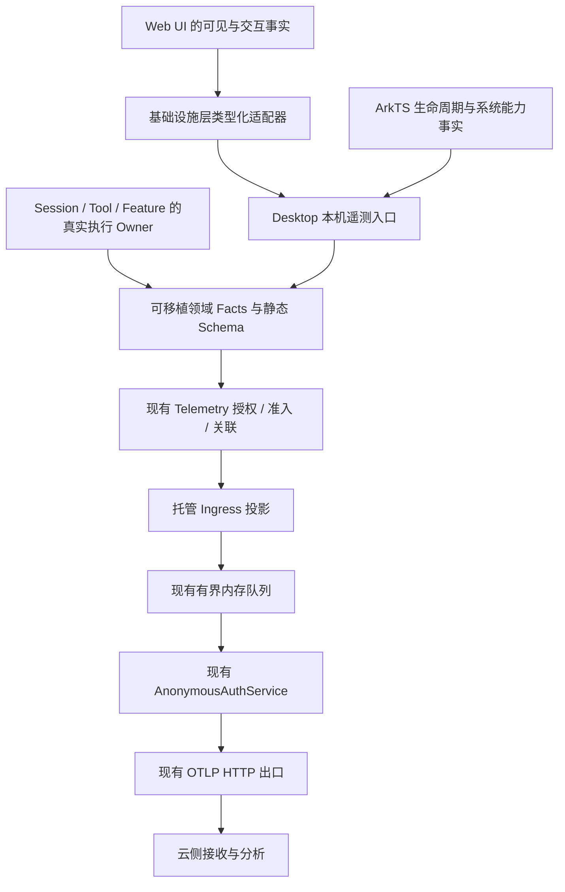

# OHOS 产品使用打点端侧设计

状态：待实现设计。本文中的新接口、字段、事件和文件划分均为目标方案，不代表当前已交付能力。

范围：`src/apps/ohos` 承载的 HarmonyOS PC / 平板 HAP，包括其 ArkTS 宿主、Desktop Rust 宿主和共享 Web UI 中在该宿主运行的功能。所有目录中的产品功能按同一份范围交付，不拆分实施批次。独立手机 App、其他 OS 产品的新增打点、云端服务和看板不在本次实现范围。

配套文档：[云侧协作说明](ohos-product-telemetry-cloud-handoff.md)、[现有 OHOS ingress](observability-ohos-ingress.md)、[现有底座实现](observability-implementation-guide.md)、[产品架构](product-architecture.md)、[远程表面契约](remote-surface-contract.md)。

本文已按所提供 `api.zip` 的 `telemetry-api.md`（变更记录到 1.3）、`telemetry-client-guide.md` v1.1 和 `auth-client-guide.md` v1.0 修订；它们是核对依据，不是新增工作的指令。与早期 `telemetry-api.zip` 的差异及对接缺口见[API 兼容性核对](ohos-product-telemetry-api-compatibility.md)。现有 HTTP 200 仅确认 MQ 接收，清洗和上墙结果必须由云侧异步核对。

## 1. 目标与职责

端侧交付一组可用于功能采用、使用转化、失败定位、性能和版本质量分析的安全事实。云端负责接收、清洗、去重、存储、聚合和展示；端侧不计算 DAU、留存、跨安装去重或满意度，不嵌入云端查询规则。

| 端侧负责 | 云侧负责 |
|---|---|
| 权威触发位置、类型化事实、字段分类、授权和准入 | 事件与字段接收白名单、类型校验、兼容接收 |
| 有界采集、时间口径、操作关联、端内去重 | 按事件 ID 去重、处理乱序、区分数据缺失 |
| 既有匿名鉴权、OTLP 编码、重试、撤回清理 | 接口可用性、限流、响应、保留和删除策略 |
| 环境和功能可用性快照、采集健康摘要 | 漏斗、活跃、留存、版本对比和看板 |
| 合成样本、字段清单、离线契约测试和真机证据 | 测试环境验收、接收结果与清洗结果核对 |

每个点位应能回答一个具体问题；点击只代表意图，业务结果由真正拥有该操作的模块记录。遥测失败不得阻止对话、构建、分享、更新、远程恢复等业务行为，不改变 Agent 循环的重试或停止规则。

## 2. 已有实现与缺口

| 当前事实 | 对本次设计的影响 |
|---|---|
| `execution/observability` 已有强类型领域 API、静态 descriptor、采样、隐私校验和 `TelemetrySink` | 扩展现有底座，不引入第三方行为分析 SDK 或任意 `track(name, properties)` |
| `services/observability-otel` 已有 OTLP、匿名授权适配、有界内存队列和重试 | 复用网络出口，不让 Web UI / ArkTS 直接上传 |
| OHOS 同意采集后为 Diagnostic；不同意为 Off；无敏感 Debug 授权 | 全部新点位服从同一政策，不能绕过授权采集首次启动 |
| 托管 ingress 当前只投影 Session、Turn、LLM、Tool、Auth 的封闭信号集 | 新增产品契约；内部已有 Startup、Permission、Compression 等也要补通投影 |
| `session.started` 包含成功创建和恢复；当前 `bitfun.session.count` 同样包含二者 | 保留旧语义；补充 operation，禁止将旧计数解释成新建数 |
| 现有模式分类和工具分类不能精确表达全部产品入口、Harness、鸿蒙工具 | 加有限的产品分类，不重命名旧分类，不上传动态工具名称 |
| `FileShareService` 返回 `pending_knock` / `dismissed` | 单独建阶段事实；不能据此发出 delivered |
| 本地 crash report 含路径、消息、堆栈 | 只接类型化故障摘要，不直接转发本地报告 |

参考实现入口：

- [领域事实](../../src/crates/execution/observability/src/domains.rs)、[出站 schema](../../src/crates/execution/observability/src/schema.rs)。
- [托管投影](../../src/crates/services/observability-otel/src/ingress_schema.rs)、[批处理](../../src/crates/services/observability-otel/src/scheduler.rs)、[传输](../../src/crates/services/observability-otel/src/transport.rs)。
- [授权控制](../../src/apps/desktop/src/api/telemetry_api.rs)、[隐私入口](../../src/apps/desktop/src/api/privacy_api.rs)、[匿名授权适配](../../src/apps/desktop/src/api/ohos/telemetry_authorizer.rs)。
- [ArkTS 宿主](../../src/apps/ohos/entry/src/main/ets/entryability/EntryAbility.ets)、[分享](../../src/apps/ohos/entry/src/main/ets/services/FileShareService.ets)、[语音](../../src/apps/ohos/entry/src/main/ets/services/VoiceInputService.ets)。

## 3. 架构与实现归属



| 模块 | 实现职责 | 限制 |
|---|---|---|
| `src/crates/execution/observability` | 按领域组织 Product Facts、有限枚举、即时事件、操作观察器、descriptor 和校验 | 不认识 OHOS API、Tauri、业务文件、配置存储或网络 |
| `src/crates/services/observability-otel` | 产品契约投影、可选能力查询适配、有界队列、健康计数 | 不判断清洗成功或某个迁移、分享、用户任务是否成功 |
| 现有业务 Owner | 在状态提交处构造事实，传入注入的 `Telemetry` | 不拼 JSON、endpoint 或任意 attribute |
| `src/apps/desktop/src/api/telemetry_api.rs` 及同目录专用模块 | OHOS 装配、授权生命周期、UI/ArkTS 入站校验、多窗口活跃合并、本地遥测小状态 | 不代理远端执行事实，不把产品 owner 移到宿主 |
| `src/apps/ohos/.../services` | 读取系统生命周期和受支持能力，输出封闭类型的摘要 | 不发送音频、屏幕、文件内容、系统完整故障报告 |
| `src/web-ui/src/infrastructure` | 类型化 `ProductTelemetryPort`、OHOS 宿主适配、可见性与单调计时 | UI 组件不直接调用 Tauri；其他平台适配器关闭新增采集 |
| `src/web-ui/src/app` / `flow_chat` / `tools` | 在真实入口调用具体语义方法，例如 `featureVisible`、`artifactCopied` | 不监听所有 DOM 点击，不截取输入内容，不转发普通日志 |

按领域拆分底座文件，例如 `product/app.rs`、`product/interaction.rs`、`product/harmony.rs`；不建立与各业务状态机平行的产品运行时。可移植 API 可以在其他宿主编译，但新增产品投影只在 OHOS delivery 装配启用；现有其他平台信号行为保持兼容。

门面增加默认关闭的产品准入策略，只由宿主根据“OHOS delivery + 当前授权 + 有效云契约”设置。未启用时新领域 API 在构造属性前返回关闭状态；复用同一个 `Telemetry` 的其他平台和标准自建 OTLP 部署不会因为业务调用新增 API 而自动开始产品采集。

### 3.1 UI 与 ArkTS 接口

新增 Tauri 命令建议命名为 `record_product_ui_observation`，使用 `{ request: ... }`。请求为带版本的封闭枚举，变体包含 `FeatureVisible`、`FeatureInvoked`、`SceneVisible`、`ActivityPulse`、`VisibleResponse`、`ArtifactInteraction` 等。每个变体有独立字段类型；禁止 `event_name: string`、动态字典和自由文本。

该接口仅证明本窗口实际观察到的事实。模型测试成功、文件写入成功、工具审批结果、迁移 Gate 通过等不可由此接口报告。字段长度、枚举、数值、因果句柄、窗口生命周期和授权代际在 Rust 再校验，不能只依赖 TypeScript。

ArkTS 采用独立的宿主内封闭 `OhosHostObservation` 桥接，承载 NativeLifecycle、Voice、Share、SystemPermission、NativeFault 等事实；禁止注册通用 ArkTS JSON 上报器。来源绑定受信任宿主，Web UI 不得伪装 ArkTS 事件。

UI 适配器在 Peer 模式下需要显式取得 controller-local transport，不能拿已经切换到 peer 的默认 API 发遥测。注册表中上述命令声明 `remote_workspace = LocalOnly`、`peer = ControllerLocal`、`cli_peer = Unsupported`；本机宿主保存 UI 事实，peer 拒绝跨主机调用。限制为受信任顶层产品 WebView，内嵌浏览器、MiniApp iframe 和第三方内容无此接口权限。

非 OHOS 宿主关闭这些新增事件；不向不支持的旧宿主反复 invoke。遥测能力缺失在本地开发诊断可见，对用户功能保持无阻塞。

请求版本固定为 1，响应为 `Recorded / Disabled / UnsupportedVersion / InvalidFacts / CapacityLimited` 的封闭状态，不把遥测错误冒泡到原业务。`Recorded` 只表示本地准入；禁止 UI 显示“已上报成功”。UI 调用异步尽力执行，不 await 网络，不因本地拒绝重试业务动作。

### 3.2 观察器与关联

业务操作使用具体 `start_*` / `finish(FinishFacts)`；即时交互使用具体 `record_*`。descriptor 声明是否产生开始事实、终态事实以及是否复用已有 Span/Metric，不能为所有交互机械地产生三种信号。

- 新产品分析以安全 OTLP Log 为事实源；新点位默认不额外导出 Span 和 Metric。
- 既有 Session / Turn / LLM / Tool 继续只由其原 owner 产生终态。本次仅在契约获支持时补字段，不生成第二份同义完成事件。
- 新产品操作开始和结束共享一个 `ObservationContext`，Log 使用 OTLP `trace_id` / `span_id` 关联。无业务父上下文时创建独立的非导出关联上下文；不是 Session ID。
- UI 与一次业务调用关联时，可由宿主提供随机、进程内有效的 observation handle，绑定窗口和授权代际。该句柄只作端内查找，不能进入云端、持久化业务数据或 Trace baggage。
- 无法关联时省略关联，保留独立 UI 事实。不能拿原始 Session、Turn、路径或设备 ID 当替代关联键。
- 后台或可能长于发起请求的操作用 Link；独立请求用独立 Root。断线重放 UI 投影不能重新发业务开始和结束。

需要测用户可见响应的本机提交路径，适配器先发送 `BeginVisibleResponse` 变体取得宿主生成的随机 handle，并在同一次提交的端内上下文携带对应 observation；该扩展不得成为已有发送请求的必填字段。handle 表最多 512 项、最长 24 小时，窗口销毁/撤回清除；容量不足或句柄过期只丢失关联，业务继续。远端没有已经协商的观测上下文时，以 controller 自己的提交至可见响应区间计时，明确其是界面耗时，不冒充远端 Turn 的子操作。

## 4. 授权、版本与持久化

### 4.1 授权状态

```text
NotAllowed -> AllowedAwaitingContract -> AllowedReady
     ^                 |                    |
     +------ 撤回 / 政策失效 ----------------+
```

只有 `AllowedReady` 可发送新产品事件；该状态由第 4.2 节的部署确认配置或已采纳的能力协商建立。`AllowedAwaitingContract` 仍按现有授权发送 V1 运行信号。不同意时不开启产品输入监听、不采集可重放的事件、不请求云端能力，不创建遥测专用安装画像。

首次同意后记录的是 `first_observed`，不宣称首次安装。老用户升级后首次可观测时带 `baseline = existing_or_unknown`。当前本地配置中可直接读取的状态允许作为授权后的状态快照，但不能伪造授权前曾发生的创建、发送、构建或分享事件。

撤回先关闭准入，再取消 exporter generation、清除待发队列、UI 本地缓存、活跃区间、milestone receipt 和故障待报摘要。旧 generation 的迟到回调必须拒绝。已送到服务器的数据无法在端侧撤回；云侧保留和删除由协作文档单独约定，不承诺取消已完成网络请求的效果。重新同意建立新的采集 epoch，不能补报撤回期间数据。

### 4.2 新旧契约并存

云侧当前 Schema v1 是闭集。新增事件必须按 `telemetry-client-guide.md` 第 5 节扩展云侧契约源 `deploy/telemetry/schema/telemetry-schema-v1.yaml` 并完成版本升级，分配的云契约版本记为 N，当前尚未确定；不能自行固定仍为 v1。旧客户端和未启用产品扩展的路径继续使用原 Schema v1。

`bitfun.product.schema.version = 1` 可以作为新产品目录的子版本提案，但它本身也是待登记字段，不能代替云侧 Schema 升级或证明已被接收。`bitfun.telemetry.schema.version` 在扩展路径如何标记 N，以及 N 如何兼容旧点位，由双方冻结机器契约；仅改托管投影的版本选择，不全局修改其他平台/自建 OTLP 的 schema 常量。若同批包含 V1 和 N 记录，按各自 Resource 分组导出，不能让 N 的声明覆盖仍按旧契约投影的信号。

附件没有现成的能力查询接口。默认启用路径为：云侧完成 N 的部署、全部合成样本上墙确认，再由 OHOS 产品部署配置固定启用该 N。配置由产品交付持有，不是用户开关，不凭 App 版本或 token 有效就推断清洗能力。

可选提出只读 `GET /telemetry/capabilities` 自动协商；它是新增云侧需求，不是此次端侧实现的既有 API。按已有 scope 职责应使用 `config:read`，不使用仅允许 OTLP 写入的 `otel:write`；详情见云侧说明。没有协商接口时不探测该 URL，使用上面的部署确认方式。若双方采用自动协商，则遵守：

- 没有成功协商到 `product_usage_v1` 及对应 N 时，保留旧投影，新产品事件停止准入。不能发未知事件让云端静默丢弃。
- 能力缓存只在内存，成功租期最长 6 小时；过期未刷新则关闭新产品准入。404、未知版本、不可读响应按不支持处理，不影响既有业务和 V1 信号。
- 重试由传输模块执行，失败至少退避 60 秒、最长 15 分钟；401 复用一次强制刷新，撤回取消请求。能力状态变化不触发业务重试。
- 等待协商期间不积压新操作和 UI 事件。就绪后发当前环境、功能和配置基线；不补造此前过程，不倒推首用时间。
- 能力启用、过期、恢复均切换产品 admission revision；旧 revision 的开始与结束不得拼成一条成功记录。被切断操作记数据覆盖缺口，不改业务结果。

全部点位在同一实现范围交付。部署确认或能力门控用于兼容旧云端，不表示按功能分批实现；二者选择必须在实现前冻结，不能把一个不存在的接口设为上线的唯一依赖。

### 4.3 遥测专用小状态

在宿主应用私有数据目录维护独立 `product-telemetry-state.json`，不混入用户设置、工作区、会话或账号记录。只允许 schema version、随机采集 epoch、里程碑枚举、采集时间、随机 event ID、应用版本及已分类故障摘要；epoch 本身不上传。

| 状态 | 生命周期 | 有界要求 |
|---|---|---|
| 当前活跃区间、窗口、曝光集合、关联句柄 | 进程内；窗口销毁或撤回失效 | 曝光集合按固定 feature/entry 枚举限定；句柄按容量淘汰，不能影响业务 |
| 已观察里程碑及待发 receipt | 当前 epoch；撤回清除 | 固定最多 16 项，总计不超过 32 KiB；待发最长 7 天 |
| 最近授权运行的故障摘要 | 下次启动获得当前授权后可报告 | 最多 8 项、7 天；不含正文、堆栈、PID、路径或平台 fault ID |
| 产品能力缓存 | 进程内；撤回清除 | 一个 ingress 的一个受支持版本集合 |

原子写入，损坏文件保留供本地诊断并禁用该项持久功能；不得删除或重置任何用户数据。未知新版本只读保留并停用该状态写入，不能按空文件覆盖。缺少新字段使用默认值；测试覆盖旧 shape 的读取和往返。

milestone receipt 首次落盘后使用同一个 event ID 重试。成功入队只表示本地接收；HTTP 200 + protobuf Content-Type + 可解析的空 ExportResponse（可以是零字节）只标记 `ingress_accepted` 并结束该 receipt 的网络重试，不标记 cleaned、stored 或 queryable。不为此持久化通用 OTLP 队列。超过期限或磁盘不可写时允许少报并计健康缺口，不循环补发或重新生成 ID。

现有 ingress 不在响应中报告下游清洗拒绝。不能为等待“上墙确认”在收到 200 后不断重发；若意外收到标准 OTLP partial_success，兼容解析并记录入口层部分拒绝，停止重发该批，不能把它解释成清洗回执，也不能自动重发被拒项。清洗问题由云侧看板/诊断定位，修正契约或端侧后由云侧受控重放 raw，而不是端侧重发已确认批次。

receipt 的 ID 由遥测服务生成并保存，重发走内部受信任接口，不能开放业务传入任意 event ID。故障补报同时要求发生时与补报时均处于允许采集状态，且属于同一未撤回 epoch；现有诊断文件存在本身不构成授权证据。7 天 receipt 补报还依赖云侧明确去重和迟到窗口；未确认前不启用跨重启已发送/响应不明的 receipt 重放，保留现有有界同批传输重试。

待发 receipt 绑定端内匿名凭据代际；同 anonymous identity 的 RT 轮换不改代际，重新 enroll 成新 anonymous identity 时停止旧代际补报，并清理其遥测待报状态，避免同一 event_id 在新 telemetry_subject 下再次计数。代际只在端内传递，不上传 anonymous_id、installation key 或旧新主体映射；不改动共享 Feedback 凭据和业务数据。

## 5. 字段与隐私契约

下文短字段名均属于 `bitfun.product.` 前缀；`duration_ms`、`result`、`error.type` 等已有字段继续使用既有名字。每个 descriptor 只选择适用字段，不把整张表塞入所有事件；单条业务属性保持不超过 32 项。

### 5.1 公共字段

| 字段 | 类型 / 有限取值 | 规则 |
|---|---|---|
| `bitfun.event_id` | SDK 生成 UUID | 每个逻辑事件固定；重试与拆包不变；禁止由业务传入 |
| `bitfun.product.schema.version` | uint，提案为 1 | 新字段待云侧登记；与云分配的 Schema N 并存，不替代 N |
| `source` | `native_host / web_ui / runtime / service` | 事实生产者，不由 UI 任意声明 |
| `trigger` | `user / agent / scheduled / system / restore / remote_user / unknown` | 只用类型化调用来源，后台续跑不能当用户操作 |
| `surface` | `ohos_main / ohos_floating / mobile_web / bot / peer / headless / unknown` | 驱动表面；不包含设备信息 |
| `scenario` | `local / remote_workspace / remote_control / peer / detached / unknown` | 主路径；更复杂组合由下面两字段补充 |
| `workspace_location` | `local / ssh / docker / peer / none / unknown` | 仅已有会话/工作区路由事实 |
| `execution_location` | `local / remote_workspace / peer / dispatch_target / none / unknown` | 不根据控制器文件路径猜测 |
| `execution_os` | `harmonyos / windows / darwin / linux / other / unknown` | 仅已知执行端事实；缺失记 unknown |
| `bitfun.result` | 仅保留 `success / error / cancelled / timeout` | 复用现有 wire 值域，不扩展共享枚举 |
| `outcome` | `success / error / cancelled / timeout / rejected / unsupported / partial / incomplete` | 新产品终态细分，待云侧登记；旧事件的 result 不改 |
| `error.type` | SafeErrorType 经现有 ingress 映射后的 wire 分类 | authentication→auth，network_*→network，tool_validation→validation，permission_denied→permission；禁止直接输出内部枚举或原始错误 |
| `bitfun.duration_ms` / 阶段耗时 | uint | 单调时钟计算，缺失省略；不填伪造 0 |
| `clock_quality` | `normal / clock_changed / unknown` | 事件 UTC 时间与单调时钟异常时的解释信息，仅适用事件带 |

Resource 继续复用入口、应用版本、渠道、架构、`os.type = harmonyos` 和进程实例 ID。云端 canonical 分析主体使用 ingress 从鉴权身份注入的 `bitfun.telemetry_subject`，并注入 `bitfun.request_id`；端侧不计算、不设置、不伪造这两个字段。

当前代码还会发送 receiver-scoped `bitfun.installation.pseudonymous_id`，它与 telemetry_subject 生成机制不同，附件未说明前者是否在 canonical 保留。本设计不依赖前者做新漏斗/去重；是否继续发送及如何关联必须让云侧确认，不自行合并两个主体或改写已有其他平台的身份机制。anonymous identity 轮换可能切断统计主体，不能宣称跨轮换的稳定安装或自然人留存。OTLP 时间戳记录发生时间，cloud receive time 由云端生成。

### 5.2 环境、配置与用户使用特征

| 字段族 | 字段和取值 | 采集规则 |
|---|---|---|
| 系统环境 | `os_major`、`api_level`、`device_form = pc_2in1 / tablet / unknown` | 来自公开系统 API，失败省略；不因采集申请额外权限 |
| 界面偏好 | `locale` 为 i18n 合同枚举；`theme = light / dark / system`；`input_kind = keyboard / pointer / touch / voice / mixed / unknown` | 只记录配置和输入类别，不记录按键、轨迹和输入值 |
| 模型配置 | `model_ready`、`auth_kind = api_key / subscription / local / none / unknown`、有限 provider/protocol 类别 | 不上传自定义名称、服务地址、账户、Key、额度余额 |
| 工作方式 | `harness_mode = minimal / standard / ultimate / creative / custom / unknown`；`agent_source = builtin / custom / external / unknown` | 来自真正生效的产品配置，不从提示词或旧 `mode_class` 猜 |
| 配置规模 | 模型、工作区、自定义 Agent、Skill、MCP、MiniApp、启用任务数量分别分桶 | 仅 owner 已持有的计数；不为遥测扫描目录、仓库或远端主机 |
| 工程类型 | `project_kind = arkts / qt / rust / javascript_typescript / python / mixed / other / unknown` | 复用已有工程检测结果；不上传包名、仓库地址和项目名 |
| 规模桶 | `0 / 1 / 2_5 / 6_20 / 21_100 / 101_plus / unknown` | 用于配置和对象数；专项大规模工程计数见对应 descriptor |
| 大小桶 | `0 / lt_100k / 100k_1m / 1m_10m / 10m_100m / 100m_plus / unknown` | 边界按字节：100,000 / 1,000,000 / 10,000,000 / 100,000,000；左闭右开 |
| 时长桶 | `lt_1s / 1s_10s / 10s_60s / 1m_10m / 10m_plus / unknown` | 精确性能耗时和语音时长分开声明，不把所有原始值当 Metric label |

静态内置模型、Agent、Skill、MiniApp 和工具可以使用审定的有限 `*_id`；动态、自定义和第三方对象统一分类为 custom / external / other，不能发送名称、名字哈希或安装路径。现有经过归一化的模型名契约保持原样；本次不扩大其自由字符串能力。

禁止采集提示词、对话文本、识别文本、音频、剪贴板正文、代码、文件名/路径、截图、网页 URL、搜索词、命令、账号/邮箱、设备唯一标识、IP 和凭据。不能通过哈希这些值绕过限制。反馈正文和用户主动导出的诊断包继续走原有独立业务协议，不并入遥测。

### 5.3 数值和枚举治理

schema 中为每个字段写明允许范围、缺失语义和是否可作 Metric label。uint 不接受负数、NaN、无穷大或超范围；统计计数饱和时加有界 overflow 标记，不悄悄截成正常值。未知本地对象映射为 other；未知协议枚举不能直接入站，按不支持该契约处理。

Resource 安装标识、实例 ID、事件 ID、Trace ID 不能作为新增 Metric label。最多用事件名、功能类别、结果、版本和少量枚举维度做聚合，避免环境、模式、工具、远程场景等维度笛卡尔积同时展开。

### 5.4 专项字段与终态约束

以下新增字段位于 `bitfun.product.`；旧 `bitfun.ttft_ms`、`gen_ai.usage.input_tokens`、`gen_ai.usage.output_tokens` 等继续使用既有名称。只在对应 descriptor 中允许。目录已经逐行列出的 operation/action 枚举为该行封闭值集，不共享一个可以任意扩充的 action 字符串。

| 字段 | 类型与有限值 / 范围 | 缺失语义 |
|---|---|---|
| `failure_stage` | `admission / validation / permission / dependency / authentication / connection / execution / persistence / render / handoff / verification / unknown` | 成功省略；失败但阶段不可知用 unknown |
| `reason` | `user_request / unavailable / feature_disabled / permission_denied / missing_dependency / incompatible_version / connection_lost / service_error / system_lifecycle / unknown` | 即时状态原因不适用时省略，不携带错误正文 |
| `snapshot_reason` | `baseline / user_change / restore / environment_change / capability_change` | 仅快照；与状态变化的 reason 分开 |
| `stop_reason` | `user_finish / user_cancel / silence / engine_end / duration_limit / permission / error / unknown` | 仅语音终态；不从转写内容推断 |
| `session_operation` | `create / resume` | 旧客户端缺字段时不能分拆为 create |
| `session_class` | 沿用既有领域枚举 | 不能用 Session 名称分类 |
| `end_reason` | 沿用 FinishReasonClass：`completed / tool_calls / cancelled / length / content_filter / max_rounds / repeated_tool_failures / error / other` | 缺失省略；不由 UI 猜 |
| `fallback`、`has_text`、`has_attachment`、`model_ready`、`usage_known`、`coverage_known`、`recovered` | bool | unknown 不得填 false；缺少证据省略 |
| `interval_ms` | uint，1..300000 | 正常周期目标 60000；超过上限的生命周期缺口不补造区间 |
| `visible_ms`、`interactive_ms` | uint，0..interval_ms；interactive <= visible | 实际测量为 0 与不可测区分；不可测不发有效区间 |
| `coverage` | `full / partial` | 时间片被截断、数据源缺失为 partial |
| `first_visible_ms`、`ttft_ms`、`wait_ms`、`queue_ms`、`recovery_ms`、各阶段 duration | uint，0..604800000 | 一周以上或无法可靠测量则省略并标 partial；不悄悄截断 |
| `since_observation_ms` | uint，0..604800000 | 同一进程起点才提供，重启后省略 |
| `input_tokens`、`output_tokens`、`cache_read_tokens`、`cache_write_tokens` | uint，0..2^53-1 | 仅 provider 的权威 usage；未知省略，不代估计费 |
| `diagnostic_count`、`finding_count`、`changed_file_count`、`item_count` | 使用第 5.2 节数量桶 | 只消费既有计数，不为打点扫描或解析内容 |
| `requested_state`、`effective_state` | `enabled / disabled / unknown` | 只用于系统开关，unsupported 不等于 disabled |
| `schedule_kind` | `once / recurring / heartbeat / other / unknown` | 不含精确 cron 或任务内容 |
| `trigger_kind` | `timer / catch_up / manual / other / unknown` | 定时 owner 提供，不从 Turn 文本推断 |
| `lateness_bucket` | `on_time / lt_1m / 1m_10m / 10m_plus / unknown` | on_time 按 scheduler 已有容忍契约；不能由采集器新设调度规则 |
| `review_kind` | `design / test / code / combined / other / unknown` | 不含审查问题和报告正文 |
| `stage` | Review：`accepted / queued / started / terminal`；连接：`discovery / authentication / handshake / transport / hydrate / ready / close / unknown` | 各 descriptor 使用自己的静态集合，不互通任意字符串 |
| `module` | `host / web_ui / agent_runtime / tool / workspace / model / browser / voice / share / update / remote / storage / other / unknown` | 不上传源码模块路径 |
| `evidence_kind` / 故障 `evidence` | `owner_result / system_event / frontend_observation / clean_marker / unavailable` | 分享 evidence 使用其单独定义；无证据不能记 crash |
| `previous_version`、`current_version`、`occurred_app_version` | 沿用 BuildVersion 校验 | 只接受构建版本；升级前版本未知则省略 |

新 O 类操作 started 必填该操作的 operation 字段（如有）和来源/路由上下文；finished 必填 result，真实失败必填经投影的 SafeErrorType，显式取消可使用 cancelled 分类，unsupported 使用有界 reason 而非伪造内部错误。started 不带 result、duration；终态耗时按可测条件提供。R 类事件保持既有必填项；旧事件的 result 映射不能因本次扩展被改变。

O 类 finished 同时必填 `bitfun.product.outcome`。映射规则：success/cancelled/timeout 保留对应 bitfun.result，其余细分状态粗粒度映射为 error；真实失败使用既有 wire error.type，unsupported/partial 等不凭空伪造内部错误，用 outcome + reason 表达。第 6 节的 result 描述均须结合 outcome 读取，云侧成功率使用 outcome 明细，不能只统计粗粒度 error。severity_text 仅 INFO/WARN/ERROR/FATAL，不能发 DEBUG/TRACE 或自由字符串。

E 类逐事件固定必填项：状态事件必填 transition/action，曝光与调用必填 feature_id/entry/availability（调用的 availability 不可测时允许 unknown），快照必填 snapshot_reason，里程碑必填 milestone/basis；不能把整行可选字段都当必填。机器契约导出时逐项固定，不允许用属性“任意可选”代替这些要求。

## 6. 全量点位目录

目录内事件名是拟定的云端 Log body。`product.<domain>.<op>.started/finished` 表示明确的两个 body，不是允许运行时拼接名称。实现通过静态枚举展开，两者各有 descriptor。开始在业务入口实际接收请求后、业务校验前记录；用户取消原生 picker 也应有终态。终态在真实状态提交后恰好一次，持久任务恢复不能重发 started。

`E` = 即时事实；`O` = started + finished 操作事实；`R` = 复用已有事件，仅补通或补字段。字段列省略第 5 节适用公共字段。所有事件均在授权和产品契约就绪后准入。

### 6.1 应用、活跃、环境与发现

| 类型 / body | 触发和字段 | Owner / 去重 |
|---|---|---|
| E `product.app.observed` | 本次进程进入可采集状态；`baseline = new_observation / existing_or_unknown`、`startup_coverage = full / post_consent / post_contract` | 宿主；每进程每 epoch 一次，不是安装事件 |
| R `product.app.startup.finished` | 补通现有 Startup owner；`result`、总耗时、native/web/ready 阶段耗时、`startup_kind = cold_process / ability_recreate / foreground_resume / web_reload` | 启动协调器；只报告采集允许后的阶段，不能追补授权前计时 |
| E `product.app.lifecycle` | foreground / background / normal_exit / web_reload；`transition`、原因类别 | ArkTS + 宿主汇合；进程级去重，非每个窗口重复 |
| E `product.app.activity` | 每 60 秒及后台/关闭时切段；`interval_ms`、`visible_ms`、`interactive_ms`、`active_surface`、`coverage` | 宿主合并窗口，区间不重叠；详见第 7 节 |
| E `product.environment.snapshot` | 就绪后及公开系统环境变化；第 5.2 节环境字段 | 宿主；每进程一次，变化才追加，不发设备品牌/型号 |
| E `product.configuration.snapshot` | 就绪后、用户成功保存关键配置后；偏好、模式、数量桶、snapshot_reason | 配置 owner；只发变化的字段组，不上传配置对象 |
| E `product.capability.snapshot` | 功能能力已知或发生变化；`feature_id`、`availability = available / disabled / unsupported / permission_required / dependency_missing / unknown`、`reason` | 现有能力 provider；每 feature 状态变化一次，不主动探测所有系统资源 |
| E `product.scene.visible` | 场景实际可见；`scene = welcome / session / agents / skills / miniapps / insights / settings / terminal / browser / other`、`entry` | Web UI；同一窗口切换一次，隐藏挂载不记 |
| E `product.feature.exposed` | 入口至少 50% 可见持续 1 秒；`feature_id`、`entry`、availability | UI；同一场景可见周期内每 feature+entry 一次；不可见不记 |
| E `product.feature.invoked` | 用户通过按钮、菜单、快捷入口实际发起；`feature_id`、`entry`、`input_kind` | UI；一次真实指令一次，组件冒泡不得重复 |
| E `product.onboarding.milestone` | `first_observed / model_ready / first_user_send / first_visible_response / first_artifact_action / first_voice_submit / first_harmony_run / first_share_handoff` | 对应 owner 提交后通知宿主；每 epoch 每项一个固定 event ID；`basis = observed_transition / baseline_state` |

里程碑包含 `since_observation_ms`，只在同一进程内有可靠单调起点时提供；跨重启不以系统时间伪造精确耗时。model_ready 可以来自当前基线，发送、响应、运行等必须来自实际新发生事件。

cold_process 从可合法采集的进程初始化边界计时；ability_recreate 从 Ability 重建边界计时；foreground_resume 从 Native 前台恢复到本次可见首帧；web_reload 从产品 WebView 重载到可交互。四者分别分析，不能把恢复耗时掺进冷启动分布。阶段在首次可采集之前已发生时省略，用 startup_coverage 表示缺口。

快照的独立字段组通过 `snapshot_group = environment / preferences / model / workspace / extension / automation` 区分；超过单条字段预算时按组发送，不用任意 JSON 或拆分数组。规模字段固定为 `model_count`、`workspace_count`、`custom_agent_count`、`skill_count`、`mcp_count`、`miniapp_count`、`enabled_schedule_count`，值使用数量桶；不可用 owner 的计数省略。环境与 capability 快照也必须带 snapshot_reason。

固定 `feature_id`：`chat / workspace / model_setup / harness / custom_agent / attachment / voice / artifact / editor / terminal / git / browser / computer_use / harmony_dev / qt_migration / deep_review / skill / mcp / plugin / acp / miniapp / memory / scheduler / remote_workspace / remote_connect / peer / dispatch / system_share / update / feedback / settings / search / account`。固定 `entry`：`welcome / sidebar / toolbar / composer / context_menu / command_palette / shortcut / settings / notification / floating / remote / other`。新增值须更新合同，不能把组件名称当值。

### 6.2 工作区、会话、模型与 Agent

| 类型 / body | 触发和字段 | Owner / 去重 |
|---|---|---|
| O `product.workspace.operation.started/finished` | create / open / restore / switch / close；`operation`、工程类型、location、失败阶段 | 工作区状态 owner；打开失败和 picker 取消均结束；不记录目录 |
| R `session.started` | 原有成功 create / resume；补 `session_operation`、session_class、路由、Harness 与 Agent 来源 | 原 Session owner；不把恢复改名成创建 |
| E `product.session.action` | fork / archive / delete / rollback / rename 成功或失败；`action`、result | 对应 Session mutation owner；rename 不上传名称；不能额外发 session.completed |
| O `product.model.configuration.started/finished` | add / edit / remove / validate / authorize / select；`operation`、provider_class、protocol、auth_kind、失败阶段 | 模型/授权 owner；select 记录实际生效，不以菜单点击当成功 |
| O `product.agent.configuration.started/finished` | create / edit / import / remove / select；`operation`、agent_source、静态 builtin_agent_id、数量桶 | Agent 配置 owner；prompt、文件和第三方名称省略 |
| E `product.harness.changed` | 模式实际生效；`previous_mode`、`harness_mode`、`scope = session / default` | 生效配置 owner；恢复配置是 restore，不当主动切换 |
| E `product.turn.started` | 复用 Turn 开始边界补出开始事实；Harness、Agent 来源、trigger、路由、输入类别、附件数量桶 | ExecutionEngine；与现有 Turn 终态同上下文 |
| R `turn.completed` | 原有结果和耗时；补 Harness、Agent 来源、trigger、结束原因、可观察的文件变更数桶 | 原 Turn owner；cancel_request 与 cancelled 终态分开 |
| E `product.chat.action` | send_rejected / cancel_requested / retry_requested / continue_requested / regenerate_requested；`action`、原因类别 | 请求接收 owner 或 UI 拒绝 owner；不重复表示 Turn 完成 |
| E `product.chat.visible_response` | 用户当前可见的回复第一次呈现；`first_visible_ms`、`visible_kind = text / tool_progress / artifact`、`response_source` | UI 渲染确认；每次提交上下文每 visible_kind 一次；历史 hydrate 不记 |
| R `llm.request.completed` | 保留当前 Token/TTFT/provider/model；补 auth_kind、cache_read_tokens / cache_write_tokens（provider 有权威值时）、`usage_known` | 模型请求 owner；缺失不是 0；不根据 Token 猜账单金额 |
| R `tool.call.completed` | 补 `tool_id`、source_class、失败阶段、是否降级、实际工具链类别 | ToolPipeline 和工具 owner；动态工具名不得上传 |

`tool_id` 的有限集合覆盖已有内置分类和本次鸿蒙关键工具：`filesystem / search / shell / git / browser / computer_use / task / skill / mcp / arkts_check / start_app / harmony_device / other`。Skill 细分通过第 6.7 节，而非任意 tool.name。通过 Shell 调用的 `devecocli build` 不解析命令文本来猜构建事件，必须从真正的构建包装器获取事实；无法获取时只保留 shell 调用。

### 6.3 输入、附件、产物、编辑器与 Git

| 类型 / body | 触发和字段 | Owner / 去重 |
|---|---|---|
| O `product.attachment.prepare.started/finished` | `attachment_source = picker / drag_drop / paste / remote_transfer`；kind、数量/大小桶、失败阶段 | 附件准备 owner；正文、文件名和 MIME 自由字符串不上传 |
| E `product.attachment.submitted` | 附件随一次真实消息提交；kind、数量桶、是否含 image/file/text | 发送 owner；准备成功不等同已发送 |
| O `product.voice.capture.started/finished` | 录音启动至 finish/cancel/error；language、duration bucket、首识别耗时、`has_text`、stop_reason、失败阶段 | VoiceInputService；每录音一次，不记录音频 chunk 或每次识别 take |
| E `product.voice.submitted` | 语音结果进入实际发送请求；录音时长桶、`edited = yes / no / unknown` | composer 发送 owner；内存中只做是否修改比较，比较内容不持久化 |
| E `product.artifact.available` | 真实产物提交/编译并进入可展示状态；kind、来源、数量桶 | 产物或 MiniApp owner；UI 每次重渲染不重发 |
| O `product.artifact.action.started/finished` | copy / export / open / accept_change / revert_change / run；kind、action、result、失败类别 | 动作执行 owner；仅当前 UI 可证明的打开记 view，不声明文件已被外部使用 |
| E `product.editor.action` | open / save / preview / ai_edit / accept_edit / undo_ai_edit；文件类别、action、result | 编辑器状态和保存 owner；不统计每次按键、自动保存不当主动 save |
| O `product.terminal.operation.started/finished` | create / reconnect / close；terminal_kind、本地/远端、result | 终端 service；命令、输出、cwd 不上报 |
| O `product.git.operation.started/finished` | diff / stage / unstage / commit / branch / pull / push / rollback；operation、result、耗时、数量桶 | Git owner；仓库/分支/提交信息不上传；后台 refresh 不算用户 Git 操作 |
| E `product.search.action` | open / execute / open_result / empty_result；scope、action、结果数桶 | 全局/文件搜索 owner；不上传查询词和搜索结果 |

附件 kind / 产物 kind 固定为 `image / code / document / spreadsheet / presentation / pdf / archive / miniapp / text / other / mixed / unknown`，根据 owner 已有类型分类，不读取内容进行遥测分类。

### 6.4 鸿蒙开发与 Qt 迁移

| 类型 / body | 触发和字段 | Owner / 去重 |
|---|---|---|
| O `product.harmony.environment.started/finished` | 用户/Agent 真实发起检查；component 类别、`availability`、版本档位、失败阶段 | 环境检查包装器；不另行运行系统命令做遥测 |
| O `product.harmony.project.started/finished` | create / import / configure；template_kind、project_kind、result | 工程创建或导入 owner；模板用静态枚举，不上传工程名 |
| O `product.harmony.check.started/finished` | ArkTS / lint / dependency 检查；check_kind、result、diagnostic_count 桶 | 对应检查执行 owner；不上传错误正文和源代码行 |
| O `product.harmony.build.started/finished` | 构建入口；`build_kind = debug / release / unknown`、toolchain、结果、失败阶段、duration | 真实构建 owner；process exit success 只表示构建成功，不表示可安装 |
| O `product.harmony.install.started/finished` | 安装已发起；target_kind、toolchain、fallback、结果、失败阶段 | 部署 owner；签名/设备权限失败保持类别，设备 ID 不上传 |
| O `product.harmony.run.started/finished` | 启动已发起；target_kind、toolchain、fallback、result、`verification = launch_ack / app_ready / unavailable` | start_app 或启动包装器；启动 ACK 不称运行验证通过 |
| E `product.harmony.device_result` | 用户/Agent 发起设备枚举完成；target_kind、数量桶、result | harmony_device；不周期扫描、不上传设备名 |
| E `product.migration.started` | 接受有效迁移任务并提交持久状态；strategy、目标类别、输入规模桶 | `services/qt-migration` 的任务提交 owner；恢复既有任务不重发 |
| E `product.migration.phase_result` | 阶段 Gate 提交；phase、`verdict = ready / blocked / invalid / unknown`、blocker_class、数量桶 | Gate/receipt 的权威写入路径；不从进度面板或 stdout 正则重建权威状态 |
| E `product.migration.lifecycle` | pause / resume / cancel / handoff / verification；action、result、completion_tier、evidence_kind | 迁移 owner；普通文案 completed 不能代替验收证据 |

component 固定为 `deveco / sdk / node / ohpm / hvigor / hdc / qt / compiler / signing / other`；toolchain 固定为 `devecocli / hdc / hvigor / native_bridge / other / unknown`；target_kind 为 `physical / emulator / unknown`。fallback 指实际发生的主路径转备用路径；原失败类别与最终结果分别保存，不把恢复成功计成失败终态。

迁移 phase 使用已有 `baseline / inventory / contract / pilot / implementation / features / diagnostics / handoff`；blocker_class 为 `environment / dependency / api_compatibility / build / signing / device / verification / permission / unknown`。面板显示状态和本地 ledger 文本均不是直接可上传材料。

### 6.5 权限、浏览器与系统能力

| 类型 / body | 触发和字段 | Owner / 去重 |
|---|---|---|
| R `product.permission.evaluation.finished` | 补通现有策略评估；permission_kind、decision、policy_source、result | ToolPipeline 权限评估 owner |
| O `product.permission.prompt.started/finished` | 显示可回答的交互至 allow/deny/cancel/timeout；permission_kind、decision、wait_ms、driver_surface | 现有审批编排；恢复弹窗不重发 started；不上传问题正文 |
| O `product.system.permission.started/finished` | 系统权限申请和最终可查询状态；microphone / screen_capture / file_access / notification；decision、result | OHOS 系统能力适配；不知道用户决定时记 unknown，不能反推 deny |
| O `product.browser.operation.started/finished` | open / connect / navigate / action / close；backend、operation、result、fallback | browser service / BrowserWebviewService；不记录 URL、标题和页面内容 |
| O `product.computer_use.operation.started/finished` | capture / action；backend、operation、result、权限类别 | computer-use owner；不上传截图、坐标、输入文本和目标应用名 |
| O `product.system.setting.started/finished` | prevent_sleep / launch_at_login / notification / tray；setting、requested_state、effective_state、result | DesktopSystemService 等；API 不支持时为 unsupported，不能伪造 false |

permission_kind 固定类别与现有权限策略对齐；policy_source 为 builtin / user / workspace / plugin / unknown。browser backend 为 `embedded_arkweb / external_cdp / other / unavailable`；不因本文假设某个后端已在 OHOS 交付，当前不可用能力上报 unsupported。

### 6.6 碰一碰、系统分享和远程协作

| 类型 / body | 触发和字段 | Owner / 去重 |
|---|---|---|
| O `product.share.prepare.started/finished` | 校验并准备本次分享；mode、kind、size_bucket、result | FileShareService；每用户请求一次 |
| E `product.share.transition` | armed / knock_detected / system_handoff / panel_shown / panel_dismissed / expired / cancelled / failed / delivered；mode、transition、error_class、`evidence` | ArkTS 分享 owner；按真实回调推进，不把 armed、dismiss 当 delivered |
| O `product.remote.connection.started/finished` | pair / connect / reconnect / disconnect；channel、scenario、stage、result、耗时 | 现有连接 owner；账号/主机/地址/端口不上传 |
| E `product.remote.transition` | disconnected / recovering / ready / incompatible / unsupported；channel、reason、`recovery_ms` | 连接状态 owner；状态变化一次，replay cursor 不上报 |
| E `product.remote.transfer` | send / receive 已有传输终态；kind、size_bucket、result、channel | 传输 owner；文件内容、名称、校验和不上传 |
| E `product.dispatch.lifecycle` | submit / accepted / running / terminal / cancel；action、result、target_capability、是否离线观察 | Dispatch 的该阶段 owner；controller accepted 不冒充 target completed |

share mode 为 `knock / discover / link`；evidence 为 `local_prepared / system_callback / receiver_ack / unavailable`。delivered 仅在受支持的可信接收确认实际存在时允许；当前 ShareKit 路径没有这样的证据时禁止发出该值。页面关闭与已交给系统分别统计。

remote channel 为 `ssh / docker / lan / relay / peer / bot / dispatch / unknown`。配对分享的 URL 不能上传；碰一碰发链接和文件共用阶段模型，但独立记录 kind。远程场景的记录职责见第 8 节。

### 6.7 扩展、MiniApp、记忆、定时与 Review

| 类型 / body | 触发和字段 | Owner / 去重 |
|---|---|---|
| O `product.extension.operation.started/finished` | discover / install / import / enable / disable / update / remove / connect；extension_kind、source_class、builtin_id、result、失败阶段 | Skill / MCP / plugin / ACP 对应 owner；扫描结果不等于已启用 |
| E `product.extension.used` | 实际解析并开始使用 Skill/扩展；extension_kind、source_class、builtin_id、用途类别 | 解析/执行 owner；出现在上下文中或列表中不算使用 |
| E `product.acp.lifecycle` | provision / start / reconnect / terminate；client_family、action、result、失败阶段 | ACP 适配/进程 owner；client_family 为有限生态类别，无命令与安装路径 |
| O `product.miniapp.operation.started/finished` | create / install / compile / launch / export / update / remove；source_class、builtin_id、operation、result | MiniApp manager/compiler/runner owner；launch 成功需要运行端 ready |
| E `product.miniapp.interaction` | 实际呈现、焦点进入、关闭；action、source_class、builtin_id、visible_duration_bucket | MiniApp 宿主；不采集 MiniApp 内用户表单或内容 |
| E `product.memory.operation` | create / update / delete / retrieve；operation、`memory_source = user / agent / imported / system / unknown`、result、条数桶、是否有命中 | Memory owner；不上传条目与检索词 |
| O `product.schedule.configuration.started/finished` | create / edit / pause / resume / delete；operation、schedule_kind、result | Scheduler owner；cron、标题、指令、确切约定时间不上传 |
| E `product.schedule.execution` | 真实触发/终态；phase、trigger_kind、lateness_bucket、result | Scheduler 执行 owner；一次调度不因重连重复；与 Agent Turn 分开计数 |
| E `product.review.lifecycle` | accepted / queued / started / terminal；stage、review_kind、queue_ms、result、finding_count 桶、coverage_known | 现有 Deep Review owner；不另建 Review 运行时或质量数据库 |
| R `product.compression.finished` | 补通压缩 owner；auto/manual、context_size_bucket、result、duration、overflow_recovery | 原 Compression owner；不上传上下文内容，不与 LLM Token 重复相加 |

extension_kind 为 `skill / mcp / plugin / acp`；source_class 为 `builtin / marketplace / imported / user / workspace / external / unknown`。builtin_id 只允许构建期审定的有限目录；没有审定项则省略。对于当前 OHOS 未提供的执行能力，采集入口可见性、attempt 和 unsupported，不用“发现配置”伪造执行能力。

### 6.8 账号状态、更新、反馈和稳定性

| 类型 / body | 触发和字段 | Owner / 去重 |
|---|---|---|
| O `product.account.operation.started/finished` | sign_in / sign_out / refresh；account_kind、operation、result、失败阶段 | 账号服务；只记录登录状态变化和结果，不上传账户身份/组织 |
| E `product.settings.changed` | 真实成功保存；setting_id、有限 bool/enum 值、scope | 设置 owner；白名单只含主题/语言/模式/浏览器开关/压缩/通知等非敏感项 |
| O `product.update.check.started/finished` | 手动/自动检查；trigger、result、`availability = available / current / unknown` | AppUpdater；请求失败不能记 current |
| E `product.update.transition` | prompt_shown / accepted / dismissed / system_handoff / failed / version_observed；transition、previous_version、current_version | 更新 owner + 下次启动；交给系统不表示安装完成 |
| O `product.feedback.submit.started/finished` | 发起提交到业务响应；category、has_attachment、result | Feedback service；不带正文、邮箱、图片和反馈业务 ID |
| E `product.client.fault` | rust_panic / native_crash / web_error / webview_terminated / unresponsive / unclean_exit；category、module、evidence、occurred_app_version、recovered | 原诊断 owner 或受支持系统事件；一个故障 receipt 一个 ID |
| E `product.client.recovery` | web_reload / startup_resume / session_restore 的真实恢复结果；recovery_kind、result、duration | 恢复 owner；不把用户手动普通打开一概叫恢复 |
| E `product.telemetry.health` | 就绪后每 15 分钟及正常退出前尽力发送；区间 admitted/enqueued/dropped/rejected/acknowledged、队列峰值、schema_state | 传输健康 owner；不观测自己来递归产生事件 |

设置白名单不包含采集授权撤回本身：撤回必须先停发，不能为了记录 opt-out 再发一次。授权同意后的当前 policy 状态可以随基线报告，但不能据此计算全体用户授权率。account_kind 为 `product / model_subscription / deveco / unknown`，不表示实际账号 ID。

无权威 crash 证据的未清洁退出只能记 unclean_exit；OS 回收、断电、强制终止不能一律算 crash。`unresponsive` 仅在可用 OS 事件或前台恢复后能证明的 UI 阻塞观察中记录，后台冻结不能算卡顿。不读取堆栈做自由文本归因。

## 7. 关键统计口径与端内去重

### 7.1 活跃与时长

`visible_ms` 是任一产品窗口处于前台且可见的时间并集；`interactive_ms` 是 visible 区间内，最近 60 秒发生过真实用户操作的时间并集。二者分开报告，不能拿阅读时间等同交互，也不能把后台 Agent 工作时长算作用户在线。

UI 只报告活动脉冲，不报告每次按键/移动；持续交互时最多每 15 秒一个脉冲。宿主以 `Instant` 和 Native 前台/焦点状态维护并集，最大 60 秒一次切段，后台、锁屏、失焦和退出立即截断。浮窗和主窗口重叠不相加。进程唤醒发现时间或生命周期缺口时截断并记 partial，不能把整段睡眠算活跃。

`product.app.activity` 只包含 OHOS 本机表面的活动；远程驾驶者的行为由 operation 的 remote_user 来源表示，不因主机后台执行产生本机 interactive_ms。挂机阅读可见时长与交互时长均是观察事实，是否计入云端“有效活跃”由协作口径定义。

activity 的 OTLP 发生时间为区间结束时刻，`interval_ms` 描述向前的单调测量跨度；云端可据此重建区间。系统时钟跳变时记录 clock_changed 和 partial，停止跨跳变点拼接，不用两次 UTC 相减修补时长。

事件用 UTC 时间戳；耗时只用所在进程单调时钟。ArkTS/Rust/Web 三个时钟分别测自己的阶段，禁止跨进程直接相减。端侧不以本地日期持久化 DAU 或 D1/D7；云端按约定时区计算。

### 7.2 操作与结果

- started 和 finished 共享 OTLP 关联上下文；多阶段操作有固定 stage 枚举。没有终态只能叫缺失终态，不能自动算失败或超时。
- finish exactly-once 使用 owner 的消费型 guard / `Option::take`；timeout、cancel、异常与成功争用同一终态。Drop incomplete 是诊断兜底。
- 网络重试保持 event ID；业务用户重试是新的操作，有新的上下文与 ID。Shell / Tool 内部重试不能重复计算用户使用次数。
- 进度变化、stream token、语音 take、目录扫描项、重放的历史消息、后台配置 hydrate 不逐条产生产品使用事件。
- 用户主动中断、策略拒绝、能力不支持、业务失败和数据不足分别保留，不强行合并为 error。

### 7.3 结果价值

复制、导出、运行、接受/撤销修改是独立行为事实；可以用于研究产物价值，不能当作任务成功或满意度真值。用户继续对话、重新生成或取消也不能单独推断不满意。本文不增加弹窗问卷或新的评价 UI；未来新增明确用户反馈应另有产品需求。

## 8. 远程场景与跨版本

OHOS 范围依据“事实由 OHOS 表面或 OHOS 宿主观察”，不能仅按控制器 OS 把远端执行称为 OHOS 执行。`os.type` 代表报告宿主，`execution_os` 代表已知执行端。

| 场景 | OHOS 侧记录 | 执行结果归属与限制 |
|---|---|---|
| 本地 | UI 交互、环境、活跃、业务终态 | 本机真实 owner；同一终态不在 UI 再发一份 |
| Remote workspace | 本机入口、远程连接、远程工作区操作与现有 owner 可确认的结果 | operation 标 location=ssh/docker；不读取本地同名路径补信息；未知远端 OS 记 unknown |
| Remote control | OHOS 作为被控宿主，记录 remote_user、mobile_web/bot、审批和执行 | 复用 RemoteCommand/权限邮箱；不为遥测新增只能在桌面回答的交互 |
| Peer Device | OHOS 控制器记录自己的 UI 和本机连接状态；OHOS 执行端记录真正业务终态 | 控制器不重报 peer 的终态；非 OHOS peer 的新执行点位不在本次交付范围 |
| Detached Dispatch | 控制器记录提交/接受；OHOS 目标存在受支持宿主时记录目标生命周期 | 不要求 controller 在线；当前仅 CLI profile 承载的目标按现有支持能力处理，本文不宣称新增 OHOS CLI 支持 |

不为了端侧打点扩大 RemoteCommand、HostInvoke 或 Dispatch 必需参数。观测上下文跨边界时只能使用已支持、已认证的 W3C envelope；对端不支持则省略跨端关联，分别记录各自可证明的阶段，不能靠版本号相等认定支持。

Peer reconnect、cursor replay、session hydrate、dispatch observer reattach 只恢复展示，不能重发业务 started/finished。新能力如果确需跨端字段，先加可选字段和类型化 capability，再覆盖旧 payload 往返；遥测缺失不得中断已有业务。ControllerLocal 遥测命令的注册和 deny set 全由 Product Operation Registry 派生。

本设计没有运行场景验证证据。实施验收必须逐项填写 local、remote_workspace、remote_control、peer、detached 的“已验证 / 明确不支持 / 未验证”，本地测试不能代替远程证据。

## 9. 出口、性能和失败路径

继续使用 Debug 测试 origin / Release 生产 origin、`/otlp/v1/{logs,traces,metrics}`、匿名 scope `otel:write` 和不压缩 protobuf。Web UI 和 ArkTS 不读取 Bearer token，不自建 HTTP client。

保留当前传输策略：相同 body 重试复用 X-Request-ID 和 Idempotency-Key；401 最多一次强制刷新；413 拆分后保留事件 ID；429 和可重试服务故障遵循既有退避及时间预算。terminal 4xx 不无穷重试；撤回取消等待和网络。

413 子 body 使用新批次 Idempotency-Key；原批次摘要不能复用于不同 body。401 刷新只在同一匿名身份下复用原 key；若共享鉴权恢复为全新身份，应终止旧代际待报，不带新 principal 重试旧批，不能依赖一次 409 才停止。

匿名鉴权统一由现有 AnonymousAuthService 承载，不因产品采集另建 enroll/refresh。新实现的验收必须包括：enroll 的 key 与 Idempotency-Key 发送前持久化、成功凭据原子提交；原 key duplicate 后仅按恢复策略换新 key，不重复撞旧 key；单进程 single-flight，存在多进程共享凭据时还要跨进程互斥；refresh 原 RT + 同 Idempotency-Key 的恢复窗口不得超过 10 分钟；403 SCOPE_INSUFFICIENT/INSTANCE_BANNED/IP_BANNED 和 409 IDEMPOTENCY_CONFLICT 不通过换身份绕过。enroll 24 小时、refresh 10 分钟是 Auth 幂等 TTL，不是 OTLP 请求或事件去重 TTL；各自重试预算不能混用。

当前默认安全队列每信号最多 2,048 条 / 8 MiB，单批最多 512 条 / 1 MiB，调度 5 秒，Metric 导出 60 秒，请求超时 10 秒，关闭 flush 预算 2 秒；重试最多 8 次、总预算 5 分钟。本文不提高这些上限。产品 Log 使用全局上限内的独立子预算，不驱逐已入队运行信号，队列调度优先保证运行故障和终态。

云客户端指南建议单请求 ≤500 条、导出 10–30 秒、离线队列约 5000 条，并称当前请求上限 4 MiB；这些建议与代码默认不同，不等于协议冲突。本次 OHOS 产品安全 Log profile 采用最多 500 条 / 1 MiB、10 秒周期以对齐建议，不全局改其他宿主；队列仍保留更严格的端侧有界预算，不默认为所有事件增加磁盘持久化。4 MiB 的部署值仍需云侧核实，413 拆包作为兼容路径保留。

产品队列子预算取 512 条 / 2 MiB，包含仍在途的记录和字节，不能在全局上限之外另加这份容量；运行 Log 至少保留 1,536 条 / 6 MiB 的容量，产品未使用的余额允许其借用。产品记录在首次编码导出前最多等待 5 分钟，超时丢弃并计本地缺口；传输重试仍最多 5 分钟。仅在采用可选能力租约时要求至少 10 分钟导出宽限；部署确认路径则维持 N 的向后接收兼容。receipt 跨重启补报必须先确认当前契约有效，不能沿用历史租约。

| 情况 | 端侧行为 |
|---|---|
| UI 高频活动 | 曝光去重、活动合并；不发输入内容和高频 DOM 事件 |
| 队列满/锁竞争 | 非阻塞丢弃，递增本地 health；不能阻塞业务，不修改业务结果 |
| 离线/超时 | 保留有界内存与既有预算；预算耗尽丢弃，不承诺跨进程完整补传 |
| 首用/故障重要摘要 | 仅第 4.3 节的小 receipt 可跨重启重试；不扩展为全事件磁盘队列 |
| App 被杀 | 最后区间和未导出内存允许缺失；没有证据不能补造 exit/crash/failed |
| 用户撤回 | 立即关闭、丢弃、取消；不发撤回事件或带旧事件的 health |
| 云端不支持/版本过期 | 仅停新产品投影，保留原 V1；本地记录有界不含敏感数据的原因 |
| 采集状态文件不可写 | 不影响业务；禁用需要可靠 receipt 的跨重启重试，标记本地覆盖缺口 |

健康计数使用区间增量，health 记录本身和可选能力查询不纳入自身 admitted/exported 计数，防止递归。acknowledged/ingress_accepted 只说明入口接收，server_rejected 只说明入口层拒绝；清洗删除、丢弃和上墙延迟在端侧不可见，不伪造 cleaned_count 或 clean_success_rate。区间摘要也可能丢失，云端不得以它反推完整端到端交付率。

性能验收：全链路采集不得在 UI 主线程执行网络/磁盘/工程扫描；记录入口目标 p95 < 1 ms；100 次/秒合成输入持续 10 分钟仍服从脉冲上限；新增内存稳定在分配子预算内；30 分钟后台空闲不应持续发产品活跃事件。测量结果随实现提交，不能把这些目标表述为已满足。

## 10. 实施文件与契约产物

| 位置 | 目标变更 |
|---|---|
| `execution/observability/src` | 产品各领域 Facts、ID 枚举、descriptor、开始/结束规则、字段和频率上限；复用 InMemorySink |
| `services/observability-otel/src/ingress_schema.rs` | 保持 V1 投影，追加经部署确认或可选协商启用的 product_usage_v1/N；旧点位补字段也受扩展门控 |
| `services/observability-otel/src` | 部署契约准入、可选能力响应适配、子预算、receipt ingress_accepted 通知和健康过滤 |
| `apps/desktop/src/api/telemetry_api.rs` 及专用模块 | 产品生命周期、UI/ArkTS DTO 校验、窗口合并、小状态；现有 controller 接入 |
| `apps/ohos/entry/src/main/ets` | 生命周期、语音、分享、更新、系统权限和可用故障事件的桥接 |
| `web-ui/src/infrastructure/product-telemetry`（拟新增） | 封闭 Port、OHOS adapter、非 OHOS 关闭实现、可见性与计时支持 |
| 现有业务 owner | 工作区、模型、配置、Agent、附件、产物、Git、迁移、扩展等在权威边界接入；不迁移 owner |
| `contracts/product-domains/src/remote_surface` 及生成物 | 新本机观测命令的唯一 stance；可选 DTO 契约与旧数据兼容 |
| `docs/architecture` | 更新本文、云侧契约和已验收的 ingress 说明，不把提案提前改成生产事实 |

从 Rust 静态 schema 导出机器可读 `product-telemetry-contract.json`（实施时新增），内容包括精确 body、字段/类型/枚举、必填性、范围、owner、频率和采集条件，以及所有合成样本。TS 类型由该契约生成或逐项契约测试，不能手工维护另一套自由枚举。

当前托管投影只支持文本和 U64 的值表示；实现新 bool 字段时须增加封闭的 Bool 投影分支并验证标准 OTLP 编码，不能把通用 Value/JSON 暴露到业务层。UI 请求 DTO 和 ArkTS DTO 是各自的入站契约，不能为了复用把 ProductTelemetryPort 的全部权限交给内嵌页面。

云端联调使用的样本覆盖本目录所有变体；机器契约与样本一并提交，任何 body/字段新增必须先更新契约。为产品日志声明最大编码大小 8 KiB，超出直接拒绝并计本地 schema 错误，不截断成不可解释的自由文本。

## 11. 验证与完成条件

文档阶段仅做链接、目录与口径审查。实现时按最近的模块指南选最小测试，不用 workspace / product-full / all-features 构建替代聚焦验证。

| 验证层 | 必须覆盖 |
|---|---|
| 领域契约 | 每个点位成功、失败、取消、超时、不支持；缺失字段；数值范围；未知枚举；每操作唯一终态 |
| 隐私准入 | 未授权无新采集/能力请求；撤回清队列/receipt/活动；旧回调拒绝；敏感探针无法通过类型和 schema |
| 云投影 | 所有目录 body 可达；旧 V1 不变；无已确认 N 不发扩展字段；每 body ≤32 属性/8 KiB；单位正确 |
| 传输 | 零字节 protobuf 成功仅确认 MQ；重试 event ID 不变；413 拆包；401 刷新；429/5xx；partial_success 兼容但不重发拒绝项；撤回竞态；断网预算与队列子预算 |
| UI | 可见性去重、隐藏挂载、历史 hydrate、双窗口并集、活动脉冲、场景销毁、可见响应首帧 |
| ArkTS 模拟 | 语音修订不增事件；权限拒绝；分享 armed/dismiss 不送达；系统 API 不支持；更新 unknown |
| 升级兼容 | 缺字段旧状态、新版本状态只读保护；旧 payload 往返；旧云能力 404；旧 peer 缺 capability |
| 真机 | 已签名 HAP，冷/热/重建启动；权限允许/拒绝/撤回；语音、分享、构建运行、更新和 WebView 故障 |
| 远程 | SSH/Docker、mobile/bot 驱动、OHOS controller/host 与旧 peer、目标离线/重连；不支持场景有明确边界 |
| 性能 | 高频交互、长任务、离线积压、后台 30 分钟、磁盘失败；无业务延迟和无界增长 |

已有命令入口示例：`cargo test -p bitfun-observability`；Web UI 使用 `pnpm --dir src/web-ui run test:run <focused-tests>`；OHOS 使用 `node --test src/apps/ohos/tests/<focused-test>.test.cjs`。OTel 新增测试应在 services 最近指南补充实际模块 filter；新增测试文件存在后再记录精确命令。新增命令/依赖边界须运行 `pnpm run capabilities:generate`、`pnpm run capabilities:check`、`pnpm run check:core-boundaries` 及 Desktop 注册闭包测试；普通 UI 代码按其指南运行 `pnpm run check:web`。

完成意味着：第 6 节每一行均有 owner、生产接线、静态 descriptor、合成样本与验证结果；功能不可用项有 unsupported 事实和测试，不能用空实现勾选；云侧 test ingress 能查到双方约定的全部事件/字段；未验证真机场景明确记录。云端看板开发和生产分析结论不属于端侧交付条件，但云端接收兼容与联调确认是启用扩展投影的必要条件。
