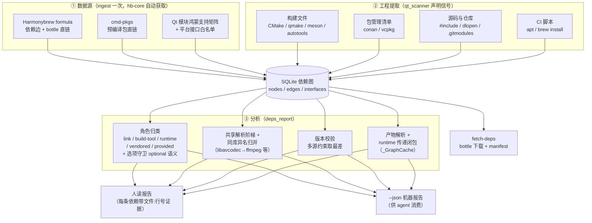

# portgraph 依赖分析 · 模块介绍报告

> 读者：第一次接触本模块的开发者与 AI agent。读完应能回答四个问题：
> **它解决什么问题？怎么设计的？吃进什么、吐出什么？做不到什么？**
> CLI 与数据源细节见 [README](README.md)，角色模型/覆盖全景见 [docs/deps-report.md](docs/deps-report.md)，
> 质量工程记录见 [docs/opt-reports/](docs/opt-reports/)。

---

## 一、它解决什么问题

场景：拿到一个陌生 Qt 桌面应用，要移植到 HarmonyOS。动手改代码之前必须先回答三个问题，portgraph 用三条命令分别回答：

| 问题 | 命令 | 输出 |
|---|---|---|
| 能不能移植？ | `analyze <app>` | portable / blocked / uncertain + 阻塞点证据 |
| **到底依赖什么？** | **`deps <路径\|应用名>`（本报告主角）** | 依赖全景：每个依赖什么角色、版本要求是否满足、鸿蒙产物从哪拿 |
| 产物从哪拿？ | `fetch-deps <app>` | bottle 直链下载 + 集成 manifest |

为什么不能靠人翻构建脚本？三个坑（以某大型 IM 应用为实证，README 声明 22 项三方依赖、闭包 112 项）：

- **漏**——依赖不只在 `find_package` 里。还藏在 `target_link_libraries` 裸名与 `ns::external_*` 导入目标、`FetchContent` 网络拉取、git submodule、CI 脚本 `apt install`、源码 `dlopen` 里，人工翻一遍很难一个不漏；
- **错**——最容易犯的错是"编译过了就没事"。交叉编译只需要 headers + 库，但应用跑在设备上还需要**传递的运行时 .so**——bottle 不捆绑依赖，漏拉一个，设备上直接起不来，而编译期毫无感知；
- **慢**——上百个依赖逐个查"鸿蒙上有没有、版本够不够"，人工要数小时且不可复现。

`deps` 一次扫描把三个坑一起填掉：该应用一次给出 **78 个 bottle 直下 + 21 个需源码移植** 的明确清单。

## 二、顶层设计（通俗版）

设计上只有三句话。

### 第一句：按"缺了会怎样"给依赖分类，而不是按"它是什么"

传统依赖清单只回答"用了 zlib"。移植者真正关心的是**缺了会发生什么**——因为补救动作完全不同：

| 角色 | 通俗说法 | 缺了的后果 | 该做什么 |
|---|---|---|---|
| `link` | 要"接进"应用的库 | 编译/链接失败 | 拿产物：bottle 直下或源码交叉编译 |
| `build-tool` | 干活的工具（cmake、protoc） | 构建机跑不起来 | 构建机装好即可，与设备无关 |
| `runtime` | 应用跑起来才需要的 .so | 设备上起不来，编译期无感知 | 部署到 `entry/libs/arm64-v8a/` |
| `vendored` / `in-tree` | 项目自带源码的库 | 无 | 随项目一起编译 |
| `provided` | Qt 模块 | 无 | 随 Qt for HarmonyOS SDK 部署 |
| `test` / `env` | 测试专用 / CI 环境清单 | — | 不进发行包 / 只作交叉核对 |

分得比这还细一点（都从构建文件原文推导，不是猜的）：

- `[optional]`：声明位于**默认 OFF 的 CMake 选项守卫**内（`if(SYSTEMD)` 而 SYSTEMD 默认关）——默认构建不含，连 optional 边，不进闭包与可移植性分析；
- `in-tree`：link 裸名命中了项目自带源码声明（FetchContent/submodule）——源码随项目编译，不是外部缺口。

### 第二句：只信构建文件原文，每个结论都能翻出证据

扫描器**不执行、不猜测**，逐行读文件里的依赖声明信号（见第三节），报告里每条依赖都附 `文件:行号` 证据——agent 引用结论时可回溯，人可复核。这就是"**LLM 负责推理、tool 负责事实**"的分工。

### 第三句：列出依赖只是半件事，还要接上"鸿蒙从哪拿"

分析器背后是一张预先建好的 SQLite 依赖图：Harmonybrew 数千个 formula 的"包→包"依赖边与 bottle 直链、cmd-pkgs 预编译包、Qt 模块鸿蒙支持矩阵。工程里捞到的每个依赖名都经**共享解析阶梯**（别名表 → 原/前后缀 → 去版本后缀 → 去构建形态后缀）对号入座——`analyze` / `deps` / `fetch-deps` 三个命令用同一个口径，同库异名不再各说各话：

- 有 bottle → 给直链 + 鸿蒙版本，并校验版本要求（`✓ 满足` / `conflict` 警告；跨名约束不可比时以 info 提示人工确认）；
- 只有源码 → 给仓库 URL，标"需源码交叉编译"；
- 是 Qt 模块 → 给鸿蒙支持状态；
- 是平台专属（X11/AppKit/iphlpapi）→ 标注不适用，交 `analyze` 的宏守卫证据判定能否裁剪。

### 运转流程



## 三、模块边界

### 3.1 输入边界——吃进什么

两类入口：本地工程路径（自动入库，幂等重扫）或已扫描应用名（用 scan 记录回溯路径）。

能识别的依赖声明信号（全部来自文件原文，按层面归类）：

| 层面 | 信号 | 举例 |
|---|---|---|
| CMake | `find_package` / `pkg_check_modules` / `target_link_libraries` 裸名·`-lfoo`·`-framework`·`ns::external_*` 导入目标 / `find_library` / `FetchContent`·`ExternalProject`·`CPM` / `find_program`·`COMMAND` / 项目自定义包装函数（`PACKAGE`/`LIBRARY` 关键字约定）/ 依赖清单引擎（`require_dep` 约定） | `find_package(OpenSSL 3.0.2 REQUIRED)` |
| qmake | `QT +=` / `LIBS += -lfoo` / `PKGCONFIG +=` | 某播放器 |
| meson | `dependency('名', version:)` / `find_library` / `meson_version`·`cpp_std` / `subproject()` | 某播放器 `glib-2.0 >= 2.36` |
| autotools | `PKG_CHECK_MODULES` / `AC_CHECK_LIB` | `zlib >= 1.2` |
| 包管理清单 | conanfile（范围 `[>=1.2 <2]`）/ vcpkg.json | 某密码管理器 |
| 源码 | `#include` 三方库头（zlib/openssl/boost 等 16 类）/ `dlopen`·`QLibrary`·`QPluginLoader` 字面量 | 某 IM 客户端 |
| 仓库结构 | `.gitmodules` / `3rdparty/` 目录 / meson `subprojects/*.wrap` | 某 IM 客户端 |
| CI 脚本 | `.github/`·`.ci/`·顶层 `*.sh` 里的 `apt/brew/pacman install` | 某截图工具 21 个 |

**看不见的**（明确不支持，报告不装懂）：`${VAR}` 引用的链接项；运行时拼接的动态库名；qmake 平台作用域块的归属区分；只写在 README/INSTALL 而构建文件从未声明的"运行期才用"的依赖；**shallow clone 未初始化的 submodule 内容**（某 IM 客户端复盘：cmake_helpers 子模块里的声明不可见，e2e 对账会如实归因而非漏报）；Bazel/Gradle/SCons 等其他构建系统。

### 3.2 分析边界——怎么处理

- **纯静态**：不执行 cmake/configure，只读文本。快、可离线、可复现；代价是动态行为看不见。
- **runtime 是推导出来的**：构建文件从不声明"我运行时需要库 X"——它由 link 依赖沿包图 runtime 边递归推导（bottle 不捆绑依赖），并给出 `needed_by` 引入链。
- **名称匹配是启发式，但口径已收敛**：别名表 + 去 lib 前缀/版本后缀/构建形态后缀 + 去分隔符归并（`LibtorrentRasterbar` ≡ `libtorrent-rasterbar`）+ 已知包名兜底索引；三命令共享同一解析函数。同名异义（多精度库 MPC vs 播放器 mpc）仍可能错配——产物 URL 落地前应人工核对。
- **版本约束取最差**：同一依赖被多来源声明版本时任一冲突即 conflict；别名归并后的跨名约束（`libavcodec >= 58` 的库主版本 vs ffmpeg 包版本）不可比时，携带 `version_req_from` 以 info 提示人工确认。
- **选项守卫是保守近似**：默认 OFF 的 `option`/`feature_option`/`cmake_dependent_option` 正向守卫内的声明标 optional；`else`/`elseif` 分支与 function/macro 体内不判定（保守视为必需）。
- **动态加载只认字面量**，且按平台宏守卫过滤（`#ifdef Q_OS_LINUX` 块内的 `dlopen("libfoo.so")` 不算鸿蒙必载）。

### 3.3 输出边界——不承诺什么

- **不保证运行时完整**：变量拼接的动态加载无法静态确定，会缺报；设备上的最终验证以实机为准。
- **不替你做决策**：optional 依赖裁不裁、版本 conflict 用旧版还是源码编新版——报告给事实与证据，决策留给 agent/人。
- **给出质量口径**：与 README/INSTALL oracle 的对账指标（召回率/精确率/Bug 候选）随 e2e 基线归档，可查证"这个工具在这批语料上的准确度"。

### 3.4 责任边界

| 分工方 | 职责 |
|---|---|
| deps 工具 | 供事实：清单、角色、版本校验、产物途径、证据行 |
| agent / 人 | 基于事实决策：裁剪、选版本、安排源码编译 |

## 四、输入 → 输出：真实走查

每个例子三段式：**工程里的原文 → 报告实际输出 → 这条输出驱动什么动作**（输出均为最新代码实测摘录）。

### 例 1：某下载器——变量版本 + 选项守卫 + 运行时推导

**输入**（两个文件配合，版本藏在 `${变量}` 里，find_package 藏在项目自带 .cmake 模块里）：

```cmake
# CMakeLists.txt
set(minBoostVersion 1.76)        # :10
set(minOpenSSLVersion 3.0.2)     # :12
set(minZlibVersion 1.2.11)       # :15

# cmake/Modules/CheckPackages.cmake（被 include() 引入）
find_package(Boost ${minBoostVersion} REQUIRED)       # :46
find_package(OpenSSL ${minOpenSSLVersion} REQUIRED)   # :47
find_package(ZLIB ${minZlibVersion} REQUIRED)         # :48
```

**输出**（报告实际摘录）：

```text
• Boost >= 1.76 ✓ (package)
    产物: https://harmonybrew.atomgit.com/bottles/boost-1.92.0_1.arm64_ohos.bottle.tar.gz
    证据: find_package(Boost 1.76 REQUIRED) cmake/Modules/CheckPackages.cmake:46
• libtorrent-rasterbar (package)
    无产物 → 需源码编译
    证据: pkg_check_modules(libtorrent-rasterbar)
• Systemd  [optional] (platform-iface)
    证据: find_package(Systemd) dist/unix/CMakeLists.txt:3
    注: systemd：鸿蒙无 systemd
── 运行时依赖 (runtime) 6 个 ──
• icu4c@78 v78.3 — 产物: …/icu4c@78-78.3_2…tar.gz（传递自 boost）
• xz v5.8.4 / zstd v1.5.7 / zlib-ng-compat / lz4 — 均传递自 boost
```

**驱动的动作**：Boost/OpenSSL/ZLIB 由 fetch-deps 直接拉 bottle；libtorrent-rasterbar 进源码交叉编译清单（find_package 的 CamelCase 名与 pkg_check_modules 的连字符名已归并为单条，不再双幽灵）；**Systemd 标 optional**——`if (SYSTEMD)` 守卫且选项默认 OFF，默认构建不含，不进闭包；**icu4c@78 等六个运行时库没出现在任何构建文件里**，但缺了设备上起不来——由 boost 的依赖边推导而来，fetch-deps 会一并拉。这就是"编译过了 ≠ 能跑"的防线。

### 例 2：某截图工具——FetchContent 自带源码 + in-tree 归并

**输入**：

```cmake
# CMakeLists.txt
FetchContent_Declare(                      # :36
  qtColorWidgets
  GIT_REPOSITORY https://gitlab.com/mattbas/Qt-Color-Widgets.git
  GIT_TAG 5d52e907e50dc88cf969b41cea44665ff6c475b1
)
find_package(KDSingleApplication-qt6 REQUIRED)   # :132（bundled 关闭时的备选路径）
```

**输出**（报告实际摘录）：

```text
• KDSingleApplication-qt6  (in-tree)
    产物: FetchContent:kdsingleApplication
    证据: find_package(KDSingleApplication-qt6 REQUIRED) CMakeLists.txt:132
    注: FetchContent（kdsingleApplication）：源码随项目编译，无需外部产物
• qhotkey  [optional] (in-tree)
    产物: FetchContent:qHotKey
    注: FetchContent（qHotKey）：源码随项目编译，无需外部产物
── 自带源码 (vendored) 3 个 ──
• qtColorWidgets (锁定 5d52e907…) https://gitlab.com/mattbas/Qt-Color-Widgets.git
• kdsingleApplication (锁定 v1.2.1) https://github.com/KDAB/KDSingleApplication.git
```

**驱动的动作**：`target_link_libraries` 里的裸名 qhotkey/QtColorWidgets 命中了项目的 FetchContent 声明，归并为 **in-tree**（源码随项目编译）——早期版本会把它们误报成"无产物→需源码编译"的外部缺口；vendored 段给出锁定的 commit，离线环境据此预置源码。

### 例 3：某 IM 客户端——自定义包装函数 + 条件块注记

**输入**（项目自定义了 `search_dependency()` 包装函数，不是任何标准 CMake 指令）：

```cmake
# cmake/Dependencies.cmake
search_dependency(LIBAVCODEC   PACKAGE libavcodec)   # :127
search_dependency(LIBEXIF      PACKAGE libexif)      # :131
search_dependency(OPENAL       PACKAGE openal)       # :135
```

**输出**（报告实际摘录）：

```text
• ffmpeg  (package)
    产物: https://harmonybrew.atomgit.com/bottles/ffmpeg-9.0.2.arm64_ohos.bottle.tar.gz
    注: 包装声明 libavcodec 归并为包 ffmpeg
• libexif (package)
    产物: …/libexif-0.6.26_1…tar.gz
    证据: search_dependency(PACKAGE libexif cmake/Dependencies.cmake)
• openal-soft (package)
    产物: https://gitcode.com/OpenHarmonyPCDeveloper/cmd-pkgs/releases/download/pkgs/openal-soft-1.24.3-ohos-aarch64.tar.gz
    证据: search_dependency(PACKAGE openal cmake/Dependencies.cmake)
• KF5  [optional] (package)
    证据: require_dep 系清单声明 KF5 (cmake/Dependencies.cmake:141) [条件块 if(KF5Sonnet_FOUND)，默认构建未必启用]
```

**驱动的动作**：包装函数按 `PACKAGE`/`LIBRARY`/`MINIMUM_VERSION` 关键字约定提取；openal 经别名解析落到 cmd-pkgs 的 openal-soft 直链；KF5 声明位于条件块内，标注"默认构建未必启用"供 agent 评估裁剪。

### 例 4：某 IM 客户端——e2e 对账（质量的输入输出）

语料最重的项目（README 22 项三方依赖、6358 个源文件），e2e 对账报告结论速览：

```text
可移植性 verdict: blocked（阻塞 7 / 未知 19 / 平台排除 2）
检出召回率 71%（12/17） | 精确率 40% | Bug 候选 3
依赖闭包 112 项（would_download 78 / need_port 21 / provided 9 / …）
```

对账把每一处差异**归因**而非含糊放过：`ns::external_*` 导入目标剥前缀收录（openal/xxhash/webrtc…）；gsl/range-v3/hunspell 按 `.gitmodules` 证据自动归 vendored；breakpad/crashpad 的漏检根因**如实标为 shallow clone 未初始化子模块**（cmake_helpers 不可见），归"疑似 README 过时/环境缺口"而非扫描器装懂。

## 五、质量保障

这个模块不是"写完就算"——配套了三层质量工程（过程记录归档 [docs/opt-reports/](docs/opt-reports/)）：

| 层 | 内容 | 规模 |
|---|---|---|
| 单元测试 | `tests/test_port_graph.py` | 120 项 |
| e2e 对账 | corpus 4 项目（代号 corpus-a~d）× oracle（README/INSTALL 人工复核）→ 召回率/精确率/Bug 候选 + 差异归因基线 | 最优基线：召回 100%/精确 100%/Bug 0 |
| 语料外泛化 | 9+ 真实项目轮测（绘画 / 文档查看 / 终端 / 音乐播放 / 视频剪辑 / 编辑器 / 逆向分析等多类型…），每轮暴露问题回流修复 | 多轮，报告归档 |

性能同轮做了工程化：runtime 闭包 BFS 共享图缓存（某大型绘画应用此前 24 万次 SQL 查询 → analyze 阶段 0.13s）；平台接口规则字面量锚点前置过滤（该应用 35MB 源码，deps 全流程 12.4s → 3.1s）。

## 六、交付件长什么样

**① deps 人读报告**：如上三例，终端直接输出，每条依赖带角色、版本校验、产物途径、`文件:行号` 证据。

**② deps --json**（agent/工具消费，结构骨架）：

```jsonc
{
  "project": {"name", "build_system", "version"},
  "qt": {"major", "min_version", "check", "modules": [...]},
  "toolchain": {"cmake_min", "cxx_standard", "tools": [...]},
  "link_deps":   [{"name", "kind", "required", "min_version",
                   "version_req", "version_req_from", "version_check",
                   "evidence": [...], "artifact": {...}}],
  "runtime_deps": [{"name", "version", "artifact", "needed_by": [...]}],
  "dynamic_loads": [...], "test_deps": [...], "vendored": [...],
  "env_deps": [...], "warnings": [{"level", "msg"}]
}
```

**③ fetch-deps 落地产物**：

```text
workspace/ohos-libs/
├── zlib/1.3.2/{include,lib,...}          # bottle 解压就绪
├── openssl@3/3.6.4/...
└── manifest-<app>.json                   # 每条目含 role/status/URL
                                           # + toolchain.cmake 可直接复制
```

**④ analyze --summary**：verdict + 阻塞点（风险等级 + 宏守卫证据）+ 平台排除项（附鸿蒙替代接口）。

**⑤ e2e 对账报告**（`tests/e2e/reports/*.report.md|.json`）：oracle × portgraph 逐条差异归因（一致/粒度折叠/构建工具/可选未启用/README 过时/★漏检/★误报），是模块准确度的可查证基线。

**⑥ 前端网页**（`python portgraph.py serve` → http://127.0.0.1:8000）：左侧 G6 依赖拓扑（节点色=移植状态，Qt 模块聚合可展开），右侧阻塞点/平台排除项/待确认项面板，节点详情抽屉含证据与产物直链：


> 网页当前呈现 analyze 的可移植性图谱与产物链接；deps 角色报告以 CLI/JSON 交付（后续可挂进节点详情）。

## 七、快速上手

```bash
python portgraph.py deps <项目路径或已扫描应用名>          # 人读报告
python portgraph.py deps <app> --json                     # 机器可读
python portgraph.py fetch-deps <app> --dry-run            # 产物预览
python portgraph.py serve                                 # 网页图谱
python portgraph/tests/e2e/run_e2e.py                     # e2e 对账（语料基线）
```
