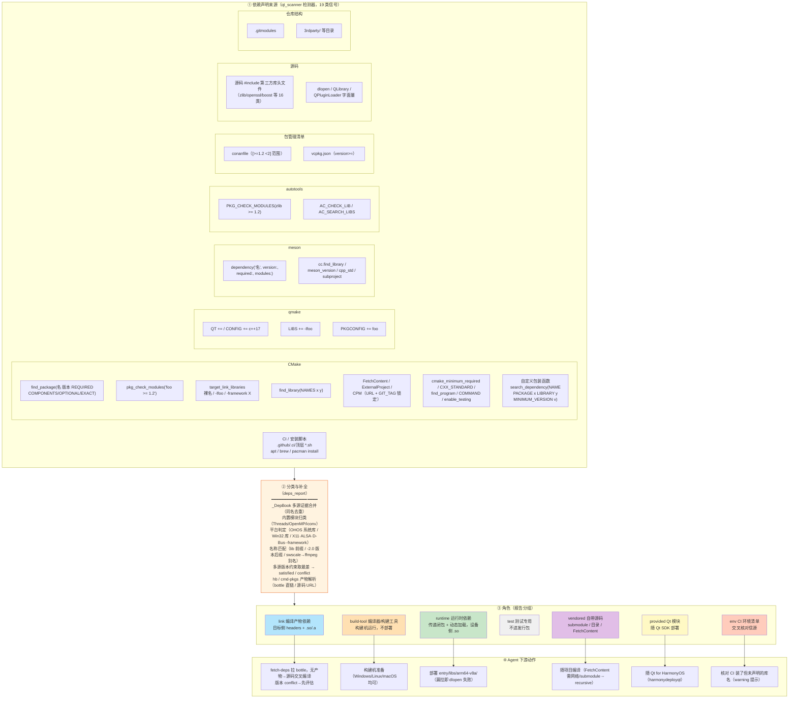

# deps — 综合依赖分析（Agent 工具）

给定一个 Qt 工程（路径或已扫描的应用名），产出**依赖全景画像**：
每个依赖是什么角色、版本要求多少、鸿蒙产物从哪拿。

```bash
python portgraph.py deps <项目路径|应用名> [--json]
```

与既有命令的分工：

| 命令 | 回答的问题 |
|---|---|
| `analyze` | 能不能移植（portable/blocked/uncertain + 阻塞点） |
| **`deps`** | **依赖全景：谁要编译产物、谁是构建工具、谁只运行时用、版本范围是否满足** |
| `fetch-deps` | 产物怎么拿（bottle 直下 / manifest / 集成片段） |

---

## 依赖角色模型

一个工程的依赖按**角色**分五类（一个依赖可同时出现在多个视角，如 gmp 既是
link 又因被 mpfr 传递依赖而出现在 runtime）：

| role | 含义 | 缺失后果 | 来源证据 |
|---|---|---|---|
| `link` | **编译产物依赖**：目标侧 headers + .so/.a，交叉编译/链接应用时必须存在 | 编译/链接失败 | `find_package`、`pkg_check_modules`、`target_link_libraries` 裸名/`-lfoo`、`find_library`、Conan/vcpkg 清单、源码 `#include` 第三方库头文件、qmake `LIBS`/`PKGCONFIG`、meson `dependency()`、autotools `PKG_CHECK_MODULES`/`AC_CHECK_LIB`、自定义包装函数 `PACKAGE`/`LIBRARY` 声明（如某 IM 客户端的 `search_dependency`）、依赖清单函数 `require_dep(…)`（如自带依赖清单引擎）、KF 组件 |
| `build-tool` | **编译器/构建工具依赖**：构建机运行，不部署到设备 | 构建无法进行（交叉编译产物不受影响） | `cmake_minimum_required`/`meson_version`、C++ 标准、`find_program`、`execute_process/add_custom_command COMMAND`、`find_package(ECM/gettext/OpenMP/…)` |
| `runtime` | **运行时依赖**：设备侧 .so，不参与编译但缺了跑不起来 | 部署后 dlopen/链接失败 | link 依赖的传递闭包（hb runtime 边）、`dlopen`/`QLibrary`/`QPluginLoader` 字面量 |
| `test` | 测试专用，不进发行包 | 测试无法构建 | `find_package(GTest/Catch2/…)`、`enable_testing` |
| `vendored` | 项目内自带源码，随项目编译，无需外部产物 | 无（锁定提交在仓库内） | `.gitmodules`、`3rdparty/` 等目录、`FetchContent_Declare`/`ExternalProject_Add`/`CPMAddPackage`（含 GIT_TAG/VERSION 锁定）、`require_source_dep(…)` 依赖清单声明（如自带依赖清单引擎）、meson `subproject()` |
| `provided` | Qt 模块等由 Qt SDK / 鸿蒙框架提供 | 无（随 Qt for HarmonyOS 部署） | `QT +=`、`find_package(Qt5/6 COMPONENTS …)`、`#include <Qt…>`、meson `dependency('qt5'/'qt6', modules: …)` |
| `env` | CI/脚本声明的**构建机环境清单**（信息性，混合工具与库，作交叉核对信源） | — | `.github`/`.ci`/顶层 `*.sh` 中 `apt/brew/pacman install` 包名 |

特殊 kind：`system-lib`（zlib/openssl/icu/pthread/threads 等系统自带或
CMake/meson 内置模块）、`win32-system-lib`（user32/ddraw/Wtsapi32.lib 等
Windows 专属）、`platform-iface`（X11/ALSA/D-Bus/`-framework` 等**直连平台
栈**，鸿蒙不支持——是否真的编译由 analyze 的宏守卫证据判定）、`framework`
（KDE Frameworks 组件，需源码交叉编译）、`raw-lib` 语义（裸链接名：未用
find_package/pkg-config 声明，产物获取途径取决于名称匹配结果）。

## 版本范围

每个 link 依赖可携带多源版本约束，**同时存在时取最差结果**（任一冲突即冲突）：

| 约束来源 | 形态 | 示例 |
|---|---|---|
| `find_package` 最低版本 | `min_version` | `find_package(ZLIB 1.2 REQUIRED)` |
| pkg-config 约束 | `version_req` | `pkg_check_modules(FF "libavcodec >= 58")` |
| meson 约束 | `version_req` | `dependency('glib-2.0', version: '>= 2.36')` |
| autotools 约束 | `version_req` | `PKG_CHECK_MODULES([F],[zlib >= 1.2])` |
| 自定义包装函数约束 | `version_req` | `search_dependency(X PACKAGE y MINIMUM_VERSION ${V})`（`${V}` 经 `set()` 变量解析（某 IM 客户端实证）） |
| Conan 范围 | `version_range`（原样保留） | `zlib/[>=1.2 <2]` |
| vcpkg 约束 | `version>=` | `vcpkg.json` dependencies |
| Qt 版本 | `qt.min_version` | `find_package(Qt5 5.15 …)` / meson `qt_req` vs 鸿蒙可用 5.12/5.15/6.12 |

`version_check` 取值：`satisfied`（满足）/ `conflict`（冲突，进 warnings）/
`any`（无约束）/ `unknown`（无可用版本可比，含 conan 范围仅近似取首个
`>=x` 检查；以及**别名归并后的跨名版本约束**——`libavcodec >= 58` 的库
主版本口径与 ffmpeg 包版本不可比，此时条目携带 `version_req_from`
指出的束库名，并以 info 警告提示需人工确认）。

## 报告结构（--json）

```jsonc
{
  "project": {"name", "root", "build_system", "version", "sources"},
  "qt": {"major", "min_version", "check", "available_on_ohos",
         "modules": [{"module", "status", "required"}], "kf_components"},
  "toolchain": {"cmake_min", "cxx_standard", "compiler", "cxx_note",
                "tools": [{"tool", "how", "provided_by": "host|qt-sdk"}],
                "has_testing"},
  "link_deps": [{
      "name", "kind", "required", "min_version", "version_req",
      "version_req_from", "version_range", "version_check",
      "components", "evidence": [...],
      "resolved_node", "port_status", "available_version",
      "artifact": {"ready", "provided", "source", "repo_url", ...},
      "ohos_note"}],
  "runtime_deps": [{"name", "version", "artifact", "needed_by": [...]}],
  "dynamic_loads": [{"name", "resolved_node", "artifact", "how"}],
  "test_deps": [{"name", "source"}],
  "vendored": [{"name", "path", "url", "tag", "note"}],
  "env_deps": [{"name", "resolved_node", "available_version", "evidence"}],
  "counts": {...}, "warnings": [{"level": "warn|info", "msg"}]
}
```

## Agent 决策表（按角色）

| 角色 | Agent 应该做什么 |
|---|---|
| `link`（有产物） | `fetch-deps` 会下载；版本 `conflict` 时先确认是否可用旧版或源码编译新版 |
| `link`（无产物） | 拿 `artifact.repo_url`/`source_url` 源码交叉编译；`[optional]` 的可评估裁剪 |
| `build-tool` | 构建机准备即可（Windows/Linux/macOS 均可）；`provided_by=qt-sdk` 的随 Qt SDK |
| `runtime` | 部署到 `entry/libs/arm64-v8a/`；由 `fetch-deps` 一并拉取（bottle 不捆绑依赖） |
| `test` | 发行包不需要；如需在鸿蒙跑测试才处理 |
| `vendored` | 随项目一起编译；FetchContent/CPM 需网络（或预置源码到 build cache）；shallow clone 后 submodule 需 `--recursive` |
| `system-lib` / `win32-system-lib` | 前者直接链接系统库；后者鸿蒙不适用（通常在平台块内） |
| `platform-iface` | 看 analyze 的守卫证据：宏守卫/平台块排除 → 可裁剪放行；无条件命中且核心路径 → 硬阻塞 |
| `env` | 交叉核对信源：CI 装了但构建文件未声明的库名会以 warning 提示（可能经变量/自定义 Find 模块引入，需补查） |

## 依赖声明覆盖全景图

deps 报告从**构建系统声明、包管理清单、源码内嵌信号、外部获取声明、
环境脚本**五个层面收集依赖，汇入统一角色模型：



读图要点：

- **同一依赖可从多来源命中**（如 zlib 同时来自 `find_package` + qmake
  `-lz` + CI `zlib1g-dev`）——`_DepBook` 按名称合并证据，多余来源不再
  产生重复条目
- **runtime 不由构建文件直接声明**：由 link 依赖经 hb/cmd-pkgs 图的
  runtime 边传递闭包推导（`needed_by` 给出引入链），加上源码
  dlopen/QLibrary 字面量
- **vendored 的四种形态**：submodule（提交锁定在仓库）/ 目录（源码在
  仓库）/ FetchContent 类（configure 期网络拉取，GIT_TAG/VERSION 锁定）/
  meson 子项目（subprojects/*.wrap 与 override_dependency 内部目标）
- **自带源码声明与 link 名的归并**（2026-09 回归轮增强）：未解析的
  link 名命中项目自带源码声明（git 子模块 / CPM-FetchContent-ExternalProject
  名或 URL 末段 / meson 子项目与内部目标）时归 `in-tree`（源码随项目编译，
  不是外部 need_port 缺口）——宽容折叠匹配（去 lib 前缀、去尾部
  qt5/qt6/system 变体 token：`qtadvanceddocking-qt6` ≡ CPM 包 `ads` 的
  URL 末段 `Qt-Advanced-Docking-System`）；已解析到产物的同名依赖追加
  "可随项目编译，bottle 为备选"注记。某 IM 客户端 kcoreaddons/microtex、
  某编辑器 ads/QSimpleUpdater、某逆向工具 rz_*/zydis 实证
- **find_package(<自身项目名>) 是自引用**：根 CMakeLists 的 project() 名
  （如 Cutter 插件样例 find_package(Cutter)）不作为外部依赖，避免误解析
  到同名无关包（cmdpkgs:cutter 实证）；vendored 子目录里 project(fakevim)
  声明的子项目名不影响宿主声明
- **env 是核对层**：不直接入 link；CI 装了但构建文件未声明的库名触发
  warning，提示可能经 `${VAR}` 引用或自定义 Find 模块引入

## 依赖闭包与扫描口径

- **性能口径**：deps 报告内所有 runtime 闭包 BFS 共享同一份节点/出边缓存
  （`_GraphCache`），图查询总量 O(V+E)；此前每个 link 依赖独立查库，
  200 依赖 × 深链图实测 24 万次 SQL 查询（某大型绘画应用实测：node 查询命中率
  83%，analyze 阶段仅 0.13s，已非瓶颈）。语料外泛化测试（2026-09）
  后的全流程瓶颈在源码扫描：平台接口规则加**字面量锚点前置过滤**
  （无锚点必无匹配，语义不变），该应用（35MB 源码）deps 全流程
  12.4s → 3.1s；剩余热点：锚点 any() 扫描本身与各检测器重复读文件
  （后续可做共享读缓存）

- **版本信息来自构建文件原文**：`find_package` 参数、pkg-config spec、
  meson `version:`、autotools `PKG_CHECK_MODULES`、Conan/vcpkg 清单、
  `.gitmodules`；`deps` 传路径时自动入库（幂等重扫），传应用名时用
  `scan` 记录的 `root_<app_id>` meta 回溯项目路径
- **同名合并**：除按 resolved_node 合并（xkbcommon/libxkbcommon）外，
  还按解析节点的规范化名（去 lib 前缀/@变体）合并——hb:qrencode 与
  cmdpkgs:libqrencode 归并为单条 qrencode 条目，多源证据保留，产物取
  有 bottle 的一侧；base 无产物而合并项有产物时采用合并项的解析结果
- **runtime 传递闭包**沿 hb/cmd-pkgs 图的 `runtime` 边递归（跳过 macos
  条件与 provided 节点），与 `fetch-deps` 口径一致
- **动态加载只识别字符串字面量**；变量拼接（`QLibrary(name + ".so")`）
  无法静态确定，会缺报——运行时验证仍需以设备为准
- **扫描期别名解析**：pkg-config/find_package 库名直接名未命中时按
  `kb_seed.PKG_ALIASES`（libavcodec→ffmpeg、xkbcommon→libxkbcommon、
  pcsc→pcsc-lite 等）重试，同库异名不再产生 pkg-unknown 幽灵节点——
  analyze / fetch-deps / deps 三个命令的名称解析口径因此一致
- **同库异名归并 + 去分隔符兑底解析**：find_package 的 CamelCase 压平名
  （`LibtorrentRasterbar` → `libtorrentrasterbar`）与 pkg-config 连字符名
  （`libtorrent-rasterbar`）指同一库，扫描期按去分隔符键分组归并为一个
  节点（不再产生重复幽灵节点/重复 need_port）；仍未命中时按
  `kb_seed.build_dashless_index`（仅收 hb:/cmdpkgs: 已知包源，键长 ≥6
  防碰撞）兑底解析到已知连字符包名
- **CMake 选项守卫（默认 OFF）内的声明标 optional**：`option` /
  `feature_option` / `feature_option_dependent` / `cmake_dependent_option`
  默认值为 OFF 的选项，其 `if(<OPTION>)` 正向守卫内的
  find_package/pkg_check_modules 视为默认构建不含（e2e 某下载器
  `if (SYSTEMD)` 复盘）：deps 报告该条目 `required=false` + 注记；
  `analyze`/`fetch-deps` 连 **optional 边**（不进入 runtime 闭包与
  可移植性分析）；Find<Name>.cmake 模块文件继承 find_package(Name)
  的守卫；同一包必需声明点与可选声明点并存时按必需（保守）。注意
  `else`/`elseif` 分支与 function/macro 体内不判定（保守视为必需）
- **共享解析阶梯（kb_seed.resolve_pkg_name）**：deps 报告与扫描期
  （project_scanner）共用同一解析函数，依次尝试：
  ① 别名表 `kb_seed.PKG_ALIASES`（hb 包名口径，如 sqlite3→sqlite、
  libavfilter→ffmpeg、gio-2.0→glib；**优先于原名**，使同库异名归并到
  同一节点，消除 sqlite3/sqlite 双产物重复下载）→ ② 原名 / 补 lib 前缀 /
  去 lib 前缀 → ③ 去 pkg-config 版本后缀（glib-2.0→glib）→ ④ 去
  find_library 构建形态后缀（jpeg-static→jpeg、libFLAC_dynamic→flac）；
  同库异名不再产生 pkg-unknown 幽灵节点——analyze / fetch-deps / deps
  三个命令的名称解析口径因此一致（未命中时幽灵节点用别名规范名，
  botan3/botan-3 合一）；构建工具/平台接口名（python3/ecm/systemd）
  在扫描期直接跳过，不建幽灵
- 工具链检测只记**已知工具名或命中特征后缀**（`*-config`/`*-scanner`/
  `*-codegen`/`glib-*`）的 `COMMAND`/`find_program` token，避免把任意
  可执行名当依赖
- CMake 依赖检测覆盖**项目自带 .cmake 模块**（`include()` 引入的
  cmake/Modules/*.cmake——某下载器工程的 CheckPackages.cmake 模式），
  并解析 `set(var x)` 变量代入 find_package/pkg_check_modules 的版本位
  （`${minBoostVersion}` → 1.76）
- 自定义包装函数检测依赖 **PACKAGE/LIBRARY 关键字约定**（启发式）：
  函数名须由项目 function()/macro() 定义、调用处带 `PACKAGE <名>` 才
  识别；其他自定义包装形式不保证覆盖
- `target_link_libraries` 排除项目内目标（add_library/add_executable）、
  `${VAR}`/生成器表达式、路径与链接 flag，只留裸库名并按 `.lib/.so/.a` 归一；
  `ns::external_<name>` 导入目标（cmake_helpers 等外部包装层约定）剥
  `external_` 前缀后作为高置信外部依赖收录（`ext_target` 标记；某 IM 客户端
  全部三方库都走这条路）；其余 `Foo::Bar`（Qt5::/PkgConfig::/项目内
  lib_*）不当作外部包声明

## fetch-deps manifest 的 role 字段

`fetch-deps` 的 manifest 每个条目新增 `role`（按闭包深度判定）：

- `link`：应用的直接依赖（depth 1，编译/链接需要）
- `runtime`：传递依赖（depth ≥2，设备侧 .so）
- `provided`：Qt 模块；`target`：应用自身
- `test`：测试框架（GTest/Catch2/…），不进发行包，仅当需在鸿蒙设备
  跑测试时才处理（status 仍随产物可用性走，bottle 存在时保留下载信息）
- `build-tool`：CMake 内置编译器特性（OpenMP，随 NDK 提供，status=
  provided）或主机构建工具包（ECM 等无产物的幽灵节点，构建机安装即可）

manifest 顶层新增 `roles` 计数。深度判定是**图口径**的近似；带版本范围/
REQUIRED/OPTIONAL 语义的精确分类用 `deps` 报告。

## 已知限制

- **libav* 版本约束不可比**：`pkg_check_modules("libavcodec >= 58")` 的版本号是
  **库主版本号**（58 ≈ ffmpeg 4.x），与 ffmpeg 发布版本（如 7.1）不同量纲。
  跨名归并到 ffmpeg 后此类约束携带 `version_req_from`（约束来源库名），
  `version_check` 记 `unknown` 而非误报 `conflict`

- **其他平台 if 块内的声明降级 required=False**：`if(APPLE)`/`if(WIN32)`/
  `if(HAIKU)`/`if(ANDROID)`/`if(SYSTEM_NAME STREQUAL "Darwin"/"Windows")`
  等平台专属块内的 target_link_libraries/find_library/pkg_check_modules
  标注 `note="位于 if(…) 平台块"` 且不入 runtime 边；`UNIX`/`LINUX`/
  `POSIX`/`OHOS` 视为鸿蒙活跃（`if(UNIX AND NOT APPLE)` 不降级），
  `NOT WIN32` 等否定条件不降级，`else` 分支保守不判（2026-09 泛化轮：
  某下载器 Darwin/Windows 块、某终端 HAIKU/FreeBSD 块、某文档查看器 mobile
  ANDROID 块、某密码管理器 FindQREncode WIN32 块、某 IM 客户端 APPLE 块实证）。
  局限：平台块内的 find_package 对 Find<Name>.cmake 模块内容的平台继承
  未实现（保守按必需处理）
- **KF 组件解析到 kf:<comp> 节点而非包名阶梯**：KF Archive ≠ libarchive、
  KF Config ≠ libconfig（同名异义），deps 表与 fetch-deps 闭包口径一致
  （kf 节点 need_port，需源码交叉编译 KF6）
- **in-tree 判定的容器名白名单**：仅 `libraries`/`libs` 父目录（或 vendored
  路径段）计为自带库集合；`generators` 等功能分组目录（某文档查看器的
  generators/poppler 是格式生成器插件代码而非 poppler 源码）不判 in-tree
- find_package 名称 → hb 包名的匹配依赖 `kb_seed.resolve_package` 别名表 +
  前缀/后缀规则，同名异义（如多精度库 MPC vs 音乐播放器 mpc）可能错配，
  产物 URL 落地前应人工核对
- Conan 范围检查为近似（取首个 `>=x`）；`<y` 上界不参与比较
- `target_link_libraries` 裸名无法区分"外部库"与"由自定义 Find 模块提供
  的目标"；`${VAR}` 引用的链接项完全不可见（CI 清单交叉核对可部分补漏）
- **未初始化子模块盲区**：shallow clone 不拉取 submodule 时，子模块内的
  find_package/集成选择逻辑不可见（某 IM 客户端的 cmake/ 即 cmake_helpers：
  breakpad/crashpad 的二选一集成在其内部实现，主仓库只能看到
  external_crash_reports 包装目标）。完整方案需 clone --recurse-submodules
  或按 .gitmodules 提示的缺失路径降级标注，当前版本作为已知残留
- CI 环境清单是发行版打包名（libfoo-dev），映射回库名为近似；且只在
  `.github/`、`.ci/`、顶层 `*.sh` 范围内收集
- meson `subproject()` 只有名字，版本取决于 subprojects/*.wrap 内容（未
  解析 .wrap）；meson 内部目标（override_dependency，如 rizin 的 rz_*）
  与 subprojects/ 自带子项目归 in-tree，不报 need_port；`'@0@'` 字符串
  插值占位符已剥离（'libpcre2-@0@' → libpcre2）
- 动态加载只识别字面量（见上）；qmake 平台作用域块（`unix {}`/`win32 {}`）
  内的依赖不区分平台归属
